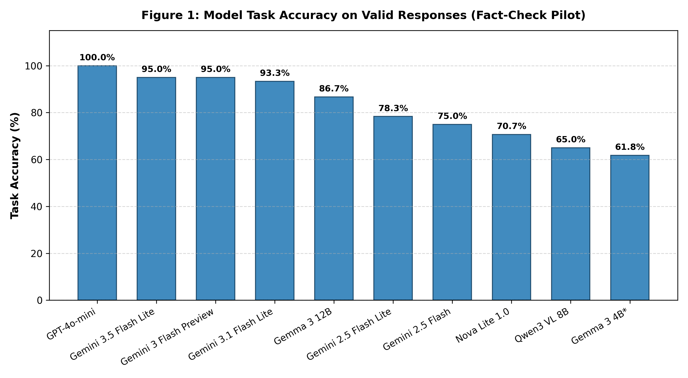
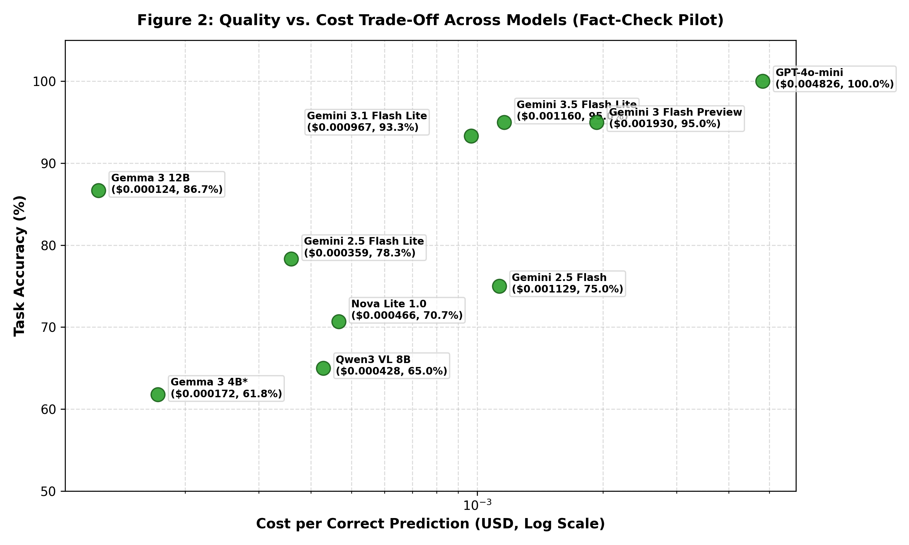
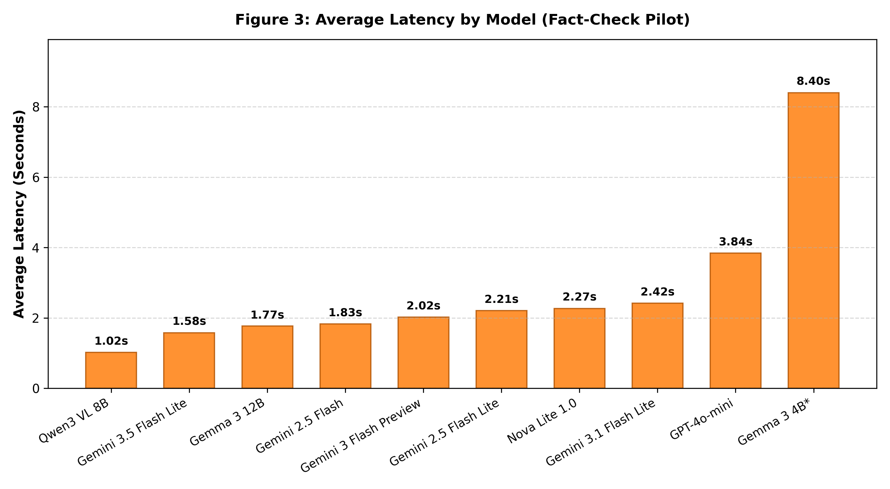
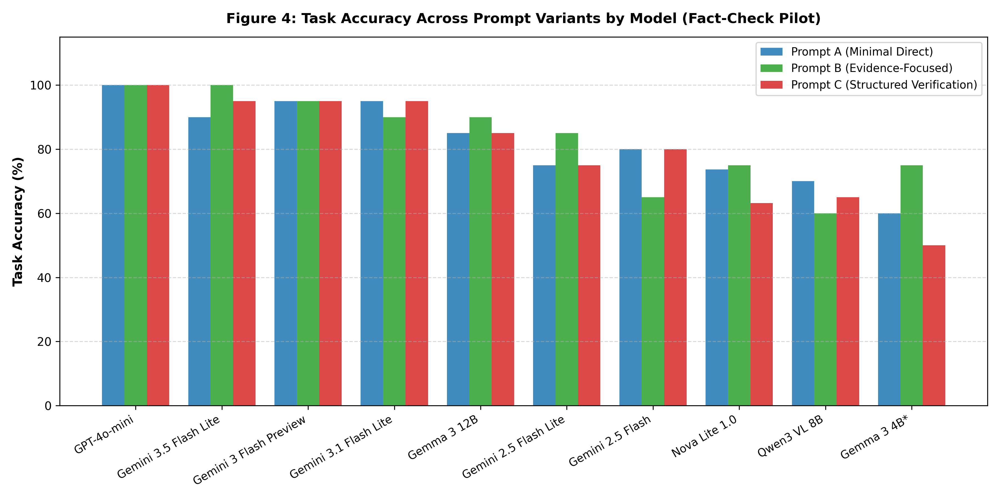

# ViChartQA OpenRouter Fact-Check Pilot Report

> **Dự án:** ViChartQA (Vietnamese Chart & Document Multi-Hop Question Answering)  
> **Thời điểm hoàn thành:** 28/09/2026  
> **Phân loại báo cáo:** Báo cáo tổng kết khảo sát sàng lọc kỹ thuật (**Full Screening Pilot Report**)  
> **Nguyên tắc dữ liệu:** Toàn bộ kết quả dựa trên dữ liệu thực nghiệm thô không chỉnh sửa tại `results/phase3_results.jsonl`, đã qua kiểm toán toàn diện tính toàn vẹn 600 experiment cells.

---

## 1. Executive Summary

Báo cáo này tổng hợp kết quả của đợt thử nghiệm **ViChartQA OpenRouter Fact-Check Pilot** nhằm khảo sát tính khả thi hạ tầng, chất lượng nhận thức đa phương thức, chi phí và độ trễ của các mô hình multimodal nhỏ trước khi triển khai các đợt đánh giá diện rộng.

- **Quy mô thực nghiệm:** 10 mô hình đa phương thức nhỏ $\times$ 20 tài liệu độc lập $\times$ 3 biến thể Prompt = **600 lượt gọi (attempts)**.
- **Trạng thái hạ tầng và thực thi:**
  - $574$ lượt gọi thành công ở tầng mạng API ($95.67\%$).
  - $26$ lượt gọi bị gián đoạn do lỗi HTTP 429 Rate Limit (tất cả đều xảy ra trên duy nhất mô hình `Google: Gemma 3 4B`).
  - $2$ lượt gọi gặp lỗi phân tích cú pháp (`parse_error`) do mô hình `Amazon: Nova Lite 1.0` trả về lỗi chính tả tiếng Việt (`<answer>Đúnh</answer>`).
  - $572$ lượt gọi có phản hồi hợp lệ hoàn chỉnh ($95.33\%$).
  - $475$ dự đoán chính xác, mang lại **E2E Accuracy toàn trình đạt 79.17%** ($475/600$) và **Task Accuracy trên phản hồi hợp lệ đạt 83.04%** ($475/572$).
- **Tổng chi phí tài chính tiêu thụ:** **$0.633373 USD** (khoảng 15.800 VNĐ).
- **Kết quả trọng tâm định hướng cho Leader:**
  - **Mô hình đạt độ chính xác cao nhất trên tập mẫu:** `OpenAI: GPT-4o-mini` đạt tuyệt đối **$100.0\%$** ($60/60$ câu đúng trên cả 3 prompt), theo sát là `Google: Gemini 3.5 Flash Lite` (**$95.0\%$**) và `Google: Gemini 3 Flash Preview` (**$95.0\%$**).
  - **Mô hình cân bằng chất lượng/chi phí nổi bật:** `Google: Gemini 3.5 Flash Lite` đạt độ chính xác $95.0\%$ (đạt $100\%$ với Prompt B), độ trễ nhanh $1.58\text{ s}$, và chi phí chỉ $\$0.001160\text{ USD/câu đúng}$ (tiết kiệm gần $76\%$ ngân sách so với GPT-4o-mini).
  - **Mô hình siêu tiết kiệm ngân sách:** `Google: Gemma 3 12B` đạt Task Accuracy **$86.7\%$** với chi phí kỷ lục chỉ $\$0.000124\text{ USD/câu đúng}$ (~3 đồng VNĐ / câu hỏi).
  - **Hiệu quả của Prompt:** Prompt B (Evidence-Focused) đạt Task Accuracy tổng thể cao nhất trong pilot (**$83.85\%$**), tuy nhiên mức độ ảnh hưởng của prompt mang tính phụ thuộc chặt chẽ vào từng mô hình cụ thể.

---

## 2. Objective

Nhiệm vụ pilot được thực hiện theo chỉ đạo của Leader nhằm trả lời các câu hỏi kỹ thuật cụ thể:
1. **Khảo sát dòng mô hình Google Gemini nhỏ trên OpenRouter:** Đánh giá thực nghiệm các biến thể Gemini 2.5 Flash Lite, Gemini 2.5 Flash, Gemini 3.1 Flash Lite, Gemini 3.5 Flash Lite, Gemini 3 Flash Preview, cùng các biến thể mã nguồn mở Gemma 3 (4B, 12B) và các mô hình đối trọng (GPT-4o-mini, Qwen3 VL 8B, Nova Lite 1.0).
2. **Cấu hình Non-Reasoning tối ưu:** Tắt hoàn toàn suy luận ẩn (`reasoning_enabled: false`), không mớm CoT để đo lường năng lực suy luận trực tiếp zero-shot nhằm kiểm soát tối đa chi phí và thời gian đáp ứng.
3. **Độ ổn định trên tập mẫu cố định:** Đánh giá trên cùng một tập mẫu 20 tài liệu thuộc ViChartQA để đảm bảo tính công bằng đối chuẩn.
4. **Nhiệm vụ Fact-Check:** Toàn bộ câu hỏi thuộc loại `question_type = "fact_check"` với đáp án chuẩn `gold_answer = "Đúng"`.
5. **So sánh 3 System Prompt:** Phân tích ảnh hưởng của lời nhắc hệ thống (Direct vs Evidence-focused vs Structured verification).
6. **Cung cấp cơ sở định lượng khách quan:** Phân tích đồng thời 4 trục: Chất lượng, Chi phí, Độ trễ và Độ tin cậy API để Leader ra quyết định lựa chọn kiến trúc mô hình cho các giai đoạn tiếp theo.

---

## 3. Experimental Setup

- **Bộ dữ liệu nguồn:** Trích xuất có kiểm soát (`RANDOM_SEED = 42`) từ 1.242 tài liệu của tập dữ liệu `process/vichartqa.json`.
- **Quy mô tập mẫu đối chuẩn (`sample_pool.json`):**
  - Gồm 20 câu hỏi tương ứng với **20 tài liệu hoàn toàn độc lập** ($100\%$ unique `doc_id`).
  - $100\%$ câu hỏi có `question_type = "fact_check"` và `gold_answer = "Đúng"`.
  - Phân bổ lĩnh vực: Kinh tế (25%), Giáo dục (15%), Xã hội (15%), Y tế (15%), Khoa học (15%), Năng lượng (10%), Môi trường (5%).
  - Chủng loại bằng chứng: 16 mẫu kết hợp đa chặng văn bản + biểu đồ (`text_and_chart`), 2 mẫu thuần văn bản (`text`), 2 mẫu đa biểu đồ liên hoàn (`charts`).
- **Đầu vào đa phương thức (Multimodal Input):**
  - Mỗi request gửi đến OpenRouter API bao gồm tiêu đề bài báo, toàn văn bài báo (born-digital text) có thẻ neo vị trí `[CHART X]`, câu hỏi kiểm chứng, và toàn bộ các hình ảnh biểu đồ gốc đính kèm (tổng cộng 35 ảnh) được mã hóa chuẩn Base64.
- **Cấu hình suy luận:**
  - `temperature = 0.0` (xác định nhất quán, giảm thiểu tính ngẫu nhiên).
  - `reasoning = {"effort": "none"}` (`reasoning_enabled: false`).
- **Ba biến thể System Prompt:**
  - **Prompt A (Minimal Direct):** Hướng dẫn ngắn gọn, yêu cầu trả lời trực tiếp Đúng/Sai đóng trong cặp thẻ `<answer>...</answer>`.
  - **Prompt B (Evidence-Focused):** Yêu cầu đối chiếu đồng thời cả thông tin ngữ cảnh trong bài báo và số liệu trực quan trên biểu đồ đính kèm trước khi đưa ra kết luận.
  - **Prompt C (Structured Verification):** Yêu cầu xác minh cấu trúc theo từng bước dữ liệu (trục, chú giải, nhãn) trước khi chốt đáp án.

---

## 4. Experiment Phases

Quá trình thực nghiệm đã trải qua 3 giai đoạn có kiểm soát chặt chẽ:

### Phase 1 — Smoke Test (Kiểm tra hạ tầng ban đầu)
- Mục tiêu: Kiểm tra kết nối API OpenRouter, cơ chế mã hóa ảnh Base64 đa phương thức, kiểm tra cấu hình `reasoning: none`, kiểm tra bộ parser regex, và ghi nhật ký logging.
- Kết quả: Hoàn thành 1 lượt gọi thành công trên mô hình Gemini, xác nhận hạ tầng kết nối ổn định.

### Phase 2 — Small Pilot (Thử nghiệm quy mô nhỏ)
- Mục tiêu: Kiểm tra pipeline chạy tự động trên ma trận nhỏ gồm 3 mô hình (`gemini-2.5-flash-lite`, `gpt-4o-mini`, `qwen3-vl-8b`), 3 mẫu câu hỏi, và 3 biến thể prompt.
- Quy mô: $3 \times 3 \times 3 = 27$ requests.
- Kết quả: $27/27$ requests thành công, chi phí tiêu thụ $\$0.0163$ USD, không ghi nhận lỗi kỹ thuật, hoàn thiện runner có cơ chế tự động ghi nhận checkpoint và phục hồi sau lỗi.

### Phase 3 — Full Screening Pilot (Thực nghiệm sàng lọc toàn diện)
- Mục tiêu: Thực thi toàn bộ ma trận thí nghiệm đối chuẩn cho 10 mô hình trên toàn bộ 20 tài liệu và 3 biến thể prompt.
- Quy mô: $10 \times 20 \times 3 = 600$ experiment cells.
- Kết quả: Ghi nhận đầy đủ 600 bản ghi dữ liệu thô vào `phase3_results.jsonl`, là nguồn dữ liệu chính thức để thực hiện kiểm toán và tổng hợp báo cáo này.

---

## 5. Data Integrity and Audit

Toàn bộ 600 bản ghi dữ liệu thô trong `phase3_results.jsonl` đã được kiểm toán tự động qua tệp `audit_phase3.py` với các phát hiện cụ thể:

- **Độ phủ tế vi (Cell Coverage):**
  - Số ô thực nghiệm dự kiến: 600 cells ($10\text{ models} \times 3\text{ prompts} \times 20\text{ samples}$).
  - Số ô thực nghiệm thực tế: 600 cells.
  - Số cell bị thiếu (`missing`): 0.
  - Số cell bị trùng lặp (`duplicate`): 0.
  - Toàn bộ 10 mô hình đều có đúng 60 bản ghi; toàn bộ 3 prompt đều có đúng 200 bản ghi; toàn bộ 20 mẫu đều có đúng 30 bản ghi.
- **Phân loại trạng thái thực thi:**
  - **API Success (HTTP 200):** $574$ requests ($95.67\%$).
  - **API Failures (HTTP 429 Rate Limit):** $26$ requests ($4.33\%$). Toàn bộ 26 lỗi này tập trung duy nhất ở mô hình `Google: Gemma 3 4B` do endpoint cộng đồng trên OpenRouter giới hạn tần suất khắt khe. 9 mô hình còn lại đạt $100\%$ API Success ($60/60$).
  - **Parse Failures (`parse_error`):** $2$ requests ($0.33\%$). Cả 2 trường hợp đều xảy ra ở `Amazon: Nova Lite 1.0` trên cùng mẫu `vichartqa_economics_00444::q5` (Prompt A và C) do mô hình sinh nhầm chính tả tiếng Việt `<answer>Đúnh</answer>`.
  - **Valid Responses:** $572$ requests ($95.33\%$) có câu trả lời phân tích cú pháp hợp lệ.
  - **Correct Predictions:** $475$ câu trả lời đúng.
- **Xác thực cấu hình Reasoning:**
  - 100% (600/600 bản ghi) ghi nhận `reasoning_enabled = False`.
  - Độ dài phản hồi dao động từ 7 đến 18 tokens, xác nhận không có mô hình nào tự ý kích hoạt sinh chuỗi tư duy ẩn (`<think>`).
- **Kiểm toán Chi phí:** Tái tính toán chi phí từ token thực tế và bảng giá catalog cho thấy 10/10 mô hình đạt trạng thái `MATCH` với độ lệch tuyệt đối $0.00000000$ USD.

---

## 6. Main Model Results

Bảng dưới đây là **BẢNG KẾT LUẬN DUY NHẤT (Table 1)** của toàn bộ đợt thử nghiệm pilot, tổng hợp đầy đủ các khía cạnh chất lượng, chi phí, độ trễ và độ tin cậy hạ tầng:

### Table 1. Pilot Model Comparison and Conclusion

| Model | Attempted | API Success | Parse Success | Correct | E2E Accuracy | Task Accuracy | Avg Latency (s) | Total Cost (USD) | Cost / Correct (USD) | Pilot Prompt Result | Pilot Interpretation |
| :--- | :---: | :---: | :---: | :---: | :---: | :---: | :---: | :---: | :---: | :---: | :--- |
| **OpenAI: GPT-4o-mini** | 60 | 60 | 60 | 60 | **100.0%** | **100.0%** | 3.84s | $0.289541 | $0.004826 | A/B/C tie (100.0%) | Highest accuracy on pilot sample pool, but higher cost and slower latency |
| **Google: Gemini 3.5 Flash Lite** | 60 | 60 | 60 | 57 | **95.0%** | **95.0%** | 1.58s | $0.066118 | $0.001160 | Prompt B (100.0%) | High accuracy, low latency, and favorable cost efficiency |
| **Google: Gemini 3 Flash Preview** | 60 | 60 | 60 | 57 | **95.0%** | **95.0%** | 2.02s | $0.110029 | $0.001930 | A/B/C tie (95.0%) | High accuracy, stable across prompts, moderate cost |
| **Google: Gemini 3.1 Flash Lite** | 60 | 60 | 60 | 56 | **93.3%** | **93.3%** | 2.42s | $0.054141 | $0.000967 | A/C tie (95.0%) | High accuracy, low cost per correct (< $0.001) |
| **Google: Gemma 3 12B** | 60 | 60 | 60 | 52 | **86.7%** | **86.7%** | 1.77s | $0.006462 | $0.000124 | Prompt B (90.0%) | Very low cost, solid open-weight model accuracy |
| **Google: Gemini 2.5 Flash Lite** | 60 | 60 | 60 | 47 | **78.3%** | **78.3%** | 2.21s | $0.016870 | $0.000359 | Prompt B (85.0%) | Low cost, moderate accuracy, notable gain with Prompt B |
| **Google: Gemini 2.5 Flash** | 60 | 60 | 60 | 45 | **75.0%** | **75.0%** | 1.83s | $0.050814 | $0.001129 | A/C tie (80.0%) | Moderate accuracy and cost, underperformed compared to Gemini 3.x Flash |
| **Amazon: Nova Lite 1.0** | 60 | 60 | 58 | 41 | 68.3% | **70.7%** | 2.27s | $0.019105 | $0.000466 | Prompt B (75.0%) | Low cost, parse reliability issue (2 typo failures on XML tags) |
| **Qwen: Qwen3 VL 8B Instruct** | 60 | 60 | 60 | 39 | 65.0% | 65.0% | **1.02s** | $0.016677 | $0.000428 | Prompt A (70.0%) | Lowest observed average latency, but lower accuracy on Vietnamese charts |
| **Google: Gemma 3 4B** | 60 | 34 | 34 | 21 | 35.0%* | **61.8%** | 8.40s** | $0.003616 | $0.000172 | Prompt B (75.0% valid) | Heavily affected by API rate limits (26 HTTP 429 errors), decent valid task accuracy |

*\*Lưu ý về Gemma 3 4B:* E2E Accuracy bị giảm xuống 35.0% do có 26 request bị lỗi mạng 429. Khi tính trên 34 phản hồi nhận được thực tế, Task Accuracy đạt 61.8%.  
*\*\*Độ trễ trung bình 8.40s* bị kéo dài do tính gộp thời gian chờ retry timeout của các request bị lỗi 429.

---

## 7. System Prompt Comparison

Thực nghiệm đã kiểm tra 200 lượt gọi cho mỗi biến thể prompt (trên 10 mô hình $\times$ 20 mẫu):

- **Prompt B (Evidence-Focused):**
  - Lượt gửi: 200. Lỗi API (429): 8. Lỗi Parse: 0. Phản hồi hợp lệ: 192. Câu đúng: 161.
  - **E2E Accuracy:** **$80.50\%$** ($161/200$).
  - **Task Accuracy (trên phản hồi hợp lệ):** **$83.85\%$** ($161/192$).
  - Độ trễ trung bình: $2,652\text{ ms } (2.65\text{ s})$. Tổng chi phí: $\$0.211256\text{ USD}$.
- **Prompt A (Minimal Direct):**
  - Lượt gửi: 200. Lỗi API (429): 10. Lỗi Parse: 1. Phản hồi hợp lệ: 189. Câu đúng: 158.
  - **E2E Accuracy:** **$79.00\%$** ($158/200$).
  - **Task Accuracy (trên phản hồi hợp lệ):** **$83.60\%$** ($158/189$).
  - Độ trễ trung bình: $2,917\text{ ms } (2.92\text{ s})$. Tổng chi phí: $\$0.209709\text{ USD}$.
- **Prompt C (Structured Verification):**
  - Lượt gửi: 200. Lỗi API (429): 8. Lỗi Parse: 1. Phản hồi hợp lệ: 191. Câu đúng: 156.
  - **E2E Accuracy:** **$78.00\%$** ($156/200$).
  - **Task Accuracy (trên phản hồi hợp lệ):** **$81.68\%$** ($156/191$).
  - Độ trễ trung bình: $2,642\text{ ms } (2.64\text{ s})$. Tổng chi phí: $\$0.212408\text{ USD}$.

### Đánh giá khoa học về Prompt Effect:
1. **Prompt B đạt kết quả tổng thể cao nhất trong pilot:** Việc bổ sung chỉ dẫn yêu cầu đối chiếu chéo số liệu giữa bài báo và biểu đồ giúp cải thiện độ chính xác trên một số mô hình như Gemini 3.5 Flash Lite (tăng từ 90% lên 100%) và Gemini 2.5 Flash Lite (tăng từ 75% lên 85%).
2. **Khoảng cách rất hẹp:** Trên tập phản hồi hợp lệ, chênh lệch giữa Prompt B ($83.85\%$) và Prompt A ($83.60\%$) chỉ là **0.25 percentage points** (đúng 3 câu trả lời đúng trên 200 lượt thử nghiệm).
3. **Hiệu quả của prompt phụ thuộc vào từng mô hình cụ thể (Model-dependent):**
   - Đối với `Gemini 3.5 Flash Lite`, Prompt B phát huy tối đa (đạt 20/20).
   - Đối với `Gemini 3.1 Flash Lite` và `Gemini 2.5 Flash`, Prompt A và C lại đạt điểm cao hơn Prompt B.
   - Đối với `Qwen3 VL 8B`, Prompt A ngắn gọn đạt kết quả cao nhất (70% vs 60% của Prompt B).
   - Đối với `GPT-4o-mini`, cả 3 prompt đều đạt 100% tuyệt đối.
   - Do đó, **không có cơ sở để kết luận một prompt là tối ưu tuyệt đối cho mọi mô hình**.

---

## 8. Cost and Latency Analysis

### 1. Phân tích chi phí (Financial Cost)
- Toàn bộ 600 lượt gọi tiêu thụ tổng cộng **$0.633373 USD**.
- **Chênh lệch chi phí giữa các mô hình rất lớn:**
  - `Google: Gemma 3 12B` có chi phí thấp nhất: $\$0.006462\text{ USD}$ cho 60 lượt gọi ($\$0.000124\text{ USD/câu đúng}$).
  - `OpenAI: GPT-4o-mini` có chi phí cao nhất: $\$0.289541\text{ USD}$ cho 60 lượt gọi ($\$0.004826\text{ USD/câu đúng}$), chiếm tới $45.7\%$ tổng ngân sách toàn đợt thử nghiệm.
  - `Google: Gemini 3.5 Flash Lite` có chi phí rất hợp lý: $\$0.066118\text{ USD}$ cho 60 lượt gọi ($\$0.001160\text{ USD/câu đúng}$), rẻ hơn GPT-4o-mini gấp 4.16 lần trong khi điểm số tiệm cận ($95\%$ vs $100\%$).
- **Hiện tượng Token kế toán của OpenAI:** GPT-4o-mini ghi nhận trung bình $32,139$ input tokens/câu (do cách tính token ảnh theo mảng gạch $512\times 512$), trong khi các mô hình Gemini chỉ ghi nhận khoảng $2,700 - 3,500$ input tokens nhờ cơ chế mã hóa vector nhúng cố định.

### 2. Phân tích độ trễ (Latency Trade-Off)
- **Mô hình nhanh nhất:** `Qwen: Qwen3 VL 8B Instruct` đạt thời gian phản hồi trung bình thấp nhất được ghi nhận trong pilot: **$1,018.2\text{ ms } (1.02\text{ s})$**, Median $963\text{ ms}$.
- **Mô hình cân bằng chất lượng/tốc độ tốt nhất:** `Google: Gemini 3.5 Flash Lite` đạt **$1,579.2\text{ ms } (1.58\text{ s})$**, Median $1,408\text{ ms}$, P95 $2,839\text{ ms}$.
- **Mô hình chậm nhất:** `OpenAI: GPT-4o-mini` đạt **$3,841.5\text{ ms } (3.84\text{ s})$**, P95 lên tới $5,891\text{ ms}$. (Gemma 3 4B trung bình $8.40\text{ s}$ do gánh thời gian chờ timeout của các request bị 429).

---

## 9. Visual Results

Dưới đây là 4 biểu đồ trực quan hóa dữ liệu đã được tạo tự động từ các bảng tổng hợp đã qua kiểm toán:

### Figure 1: Model Task Accuracy
Biểu đồ cột sắp xếp theo Task Accuracy trên các phản hồi hợp lệ của 10 mô hình:

### Figure 2: Accuracy vs. Cost Trade-Off
Biểu đồ phân tán đối chuẩn tương quan giữa Chi phí trên mỗi câu trả lời đúng (trục hoành log-scale) và Task Accuracy (trục tung):

### Figure 3: Average Latency by Model
Biểu đồ so sánh độ trễ phản hồi trung bình (tính bằng giây) giữa các mô hình:

### Figure 4: Prompt Accuracy by Model
Biểu đồ cột nhóm so sánh Task Accuracy giữa 3 biến thể Prompt trên từng mô hình:

---

## 10. Key Findings

Để trả lời 3 câu hỏi cốt lõi mà Leader cần làm căn cứ quyết định:

### 1. Model nào có kết quả chất lượng cao trong pilot?
- **OpenAI: GPT-4o-mini:** Đạt độ chính xác tuyệt đối **$100.0\%$** ($60/60$ câu đúng trên toàn bộ 3 prompt), thể hiện năng lực hiểu biểu đồ và văn bản tiếng Việt xuất sắc nhất trên tập mẫu pilot.
- **Google: Gemini 3.5 Flash Lite:** Đạt độ chính xác **$95.0\%$** ($57/60$ câu đúng) và **chạm mốc hoàn hảo $100.0\%$ ($20/20$) khi kết hợp với Prompt B**. Đây là model có chất lượng cao nhất trong toàn bộ họ mô hình Google Gemini nhỏ được khảo sát.
- **Google: Gemini 3 Flash Preview:** Cũng đạt độ chính xác cao $95.0\%$ ($57/60$), đồng đều trên cả 3 prompt.

### 2. Model nào có cost/quality đáng chú ý?
- **Lựa chọn cân bằng tối ưu toàn diện nhất:** **`google/gemini-3.5-flash-lite`**
  - Task Accuracy: **$95.0\%$** (tiệm cận GPT-4o-mini).
  - Tốc độ phản hồi: **$1.58\text{ s}$** (nhanh hơn GPT-4o-mini 2.43 lần).
  - Chi phí: **$\$0.001160\text{ USD/câu đúng}$** (tiết kiệm gần $76\%$ chi phí so với GPT-4o-mini).
- **Lựa chọn siêu tiết kiệm ngân sách:** **`google/gemma-3-12b-it`**
  - Task Accuracy: **$86.7\%$** ($52/60$).
  - Chi phí kỷ lục: **$\$0.000124\text{ USD/câu đúng}$** (chỉ tốn khoảng 3 đồng VNĐ / câu hỏi, rẻ hơn GPT-4o-mini gần 39 lần).

### 3. Prompt nào cho kết quả cao nhất trong pilot?
- **Prompt B (Evidence-Focused):** Đạt kết quả cao nhất trong pilot với **$83.85\%$** Task Accuracy trên các phản hồi hợp lệ ($161/192$) và **$80.50\%$** E2E Accuracy ($161/200$).
- Lời nhắc tường minh yêu cầu đối chiếu chéo thông tin giữa bài viết và biểu đồ giúp mô hình tập trung bằng chứng tốt hơn mà không làm phát sinh thêm chi phí token đáng kể (chênh lệch dưới $0.7\%$ chi phí so với Prompt A).

---

## 11. Limitations

Báo cáo ghi nhận các giới hạn phương pháp luận nghiêm ngặt của đợt thử nghiệm này:
1. **Quy mô tập mẫu nhỏ ($N = 20$ tài liệu):** Tập mẫu được thiết kế cho mục đích sàng lọc (Screening Pilot), không đủ sức mạnh thống kê để khái quát hóa cho toàn bộ bộ dữ liệu ViChartQA (1.242 tài liệu). Khoảng tin cậy Wilson 95% có biên sai số từ $\pm 8\%$ đến $\pm 14\%$.
2. **Đơn nhãn (Single-class Imbalance: 100% "Đúng"):** Toàn bộ 20 câu hỏi đều có nhãn chuẩn là `"Đúng"`. Thực nghiệm này đo lường khả năng nhận diện mệnh đề đúng (Recall / True Positive Rate), **không đo lường khả năng phân biệt Đúng - Sai (True-vs-False Discrimination)** và không kiểm tra được nguy cơ mô hình mắc thiên vị đồng thuận ("Yes-bias").
3. **Ảnh hưởng gián đoạn hạ tầng API:** Mô hình `Google: Gemma 3 4B` bị ảnh hưởng nặng nề bởi 26 lỗi HTTP 429 Rate Limit trên OpenRouter, làm sai lệch E2E Accuracy nếu không phân tách mẫu số hợp lệ.
4. **Độ nhạy chính tả tiếng Việt:** `Amazon: Nova Lite 1.0` có 2 lỗi phân tích cú pháp do gõ nhầm chính tả (`<answer>Đúnh</answer>`), cho thấy cần chú ý tới tính ổn định sinh thẻ XML tiếng Việt của một số mô hình.
5. **Chênh lệch giữa các prompt khá nhỏ:** Khoảng cách giữa Prompt B và Prompt A chỉ là $0.25$ percentage points trên các phản hồi hợp lệ, phản ánh sự cải thiện mang tính cục bộ theo mô hình thay vì tính vượt trội toàn cục.

---

## 12. Recommended Next Step

Dựa trên kết quả thực tế, nhóm nghiên cứu đề xuất các bước triển khai tiếp theo để Leader xem xét:
1. **Lựa chọn mô hình cho Benchmark chính thức:**
   - Đưa **`google/gemini-3.5-flash-lite`** làm mô hình trọng tâm hàng đầu cho pipeline chính thức nhờ cân bằng xuất sắc giữa chất lượng ($95\%$), độ trễ ($1.58\text{ s}$) và chi phí thấp.
   - Giữ lại **`openai/gpt-4o-mini`** làm mốc trần đối chuẩn chất lượng cao ($100\%$).
   - Cân nhắc **`google/gemma-3-12b-it`** cho các kịch bản suy luận biên hoặc tự host nội bộ chi phí siêu rẻ.
2. **Mở rộng tập mẫu đối chuẩn:**
   - Xây dựng tập mẫu đánh giá lớn hơn ($N \ge 100$ tài liệu).
   - **Bắt buộc bổ sung các câu hỏi có nhãn `gold_answer = "Sai"`** (tỷ lệ 50/50 Đúng/Sai) để đo lường đầy đủ Precision, Specificity, F1-Score và Balanced Accuracy.
3. **Tối ưu hóa Prompt:** Sử dụng Prompt B làm mẫu prompt cơ sở, kết hợp tinh chỉnh nhẹ format để tránh lỗi chính tả như đã gặp trên Nova Lite.
