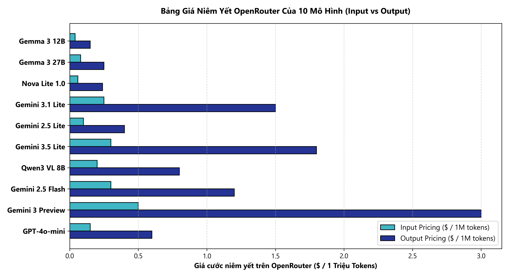
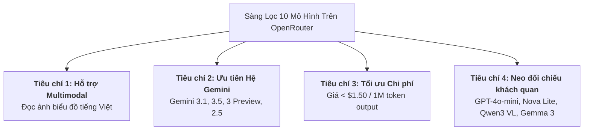

# BÁO CÁO NGHIÊN CỨU LỰA CHỌN MODEL VÀ SYSTEM PROMPT CHO BÀI TOÁN FACT-CHECK BIỂU ĐỒ (VICHAARTQA BALANCED V1)

---

### BIỂU ĐỒ BẢNG GIÁ VÀ CHI PHÍ TOKEN CÁC MÔ HÌNH ỨNG VIÊN

---

## 1. YÊU CẦU CỦA LEADER VÀ ĐỊNH HƯỚNG NGHIÊN CỨU

Trong chỉ đạo giao nhiệm vụ nghiên cứu, Leader đã xác định rõ các tiêu chí cốt lõi:

> *“Xem thống kê lại coi model nào chất lượng oke nhất, cost tối ưu nhất lẫn cách viết system prompt sao cho hiệu quả nhất, chi phí kiếm cái rẻ ở mức vừa phải thôi đừng có cố kiếm mấy cái rẻ bèo thì model không chất lượng lắm xong rồi báo t nha, ưu tiên dòng Gemini vì cách giao tiếp của nó giống người nhất.”*

### Các nguyên tắc nghiên cứu được thiết lập:
1. **Ưu tiên dòng Google Gemini:** Do khả năng xử lý ngữ cảnh đa phương thức (Multimodal Native) tiên tiến, năng lực đọc biểu đồ sắc bén và văn phong phản hồi tự nhiên, gần gũi với con người nhất.
2. **Không chạy đua theo giá rẻ cực đoan:** Không chọn các mô hình chỉ vì đơn giá siêu rẻ nếu mô hình đó thường xuyên đoán mò, không nhận diện được lỗi sai trên biểu đồ (Recall lớp `"Sai"` thấp) hoặc hay vỡ định dạng cấu trúc đầu ra.
3. **Tối ưu hóa System Prompt:** Tìm kiếm cấu trúc chỉ dẫn giúp mô hình suy luận vững chắc, tuân thủ định dạng thẻ tag `<answer>Đúng</answer>` / `<answer>Sai</answer>` tuyệt đối, triệt tiêu thiên lệch (bias) về nhãn ĐÚNG.
4. **Kiểm soát ngân sách tuyệt đối:** Toàn bộ quá trình đánh giá và thực nghiệm phải nằm gọn dưới trần ngân sách **35 USD**.

---

## 2. KHẢO SÁT DANH SÁCH MÔ HÌNH VÀ BẢNG THÔNG SỐ HIỆN HÀNH

Khảo sát toàn diện hệ sinh thái mô hình thị giác ngôn ngữ (Vision-Language Models) trên cổng OpenRouter tại thời điểm tháng 10/2026.

### Bảng đối chiếu Shortlist 10 mô hình tham gia khảo sát:

| STT | Model Slug chính xác | Tên hiển thị chuẩn | Nhà phát triển | Vai trò nghiên cứu | Trạng thái Vòng đời (Lifecycle) | Context Length | Đơn giá Input ($/1M) | Đơn giá Output ($/1M) | Khả năng Vision |
|:---:|---|---|---|---|---|:---:|:---:|:---:|:---:|
| 1 | `google/gemini-3.1-flash-lite` | Gemini 3.1 Flash Lite | Google | **Ứng viên số 1** | **GA_ACTIVE** | 1.048.576 | $0,25 | $1,50 | Hỗ trợ ảnh native |
| 2 | `google/gemini-3.5-flash-lite` | Gemini 3.5 Flash Lite | Google | **Ứng viên số 2 (Dự phòng)** | ACTIVE | 1.048.576 | $0,30 | $2,50 | Hỗ trợ ảnh native |
| 3 | `google/gemini-3-flash-preview` | Gemini 3 Flash Preview | Google | Ứng viên nghiên cứu | PREVIEW_ACTIVE | 1.048.576 | $0,50 | $3,00 | Hỗ trợ ảnh native |
| 4 | `amazon/nova-lite-v1` | Nova Lite 1.0 | Amazon | Neo đối chiếu ngoài Google | ACTIVE | 300.000 | $0,06 | $0,24 | Hỗ trợ ảnh |
| 5 | `google/gemma-3-12b-it` | Gemma 3 12B Instruct | Google | Neo trọng số mở | ACTIVE | 131.072 | $0,05 | $0,15 | Hỗ trợ ảnh |
| 6 | `google/gemma-3-27b-it` | Gemma 3 27B Instruct | Google | Neo trọng số mở (thay thế 4B) | ACTIVE | 131.072 | $0,08 | $0,45 | Hỗ trợ ảnh |
| 7 | `google/gemini-2.5-flash` | Gemini 2.5 Flash | Google | Baseline tham chiếu lịch sử | **DEPRECATION (20/10/2026)** | 1.048.576 | $0,30 | $2,50 | Hỗ trợ ảnh |
| 8 | `google/gemini-2.5-flash-lite` | Gemini 2.5 Flash Lite | Google | Baseline tham chiếu lịch sử | **DEPRECATION (20/10/2026)** | 1.048.576 | $0,10 | $0,40 | Hỗ trợ ảnh |
| 9 | `openai/gpt-4o-mini` | GPT-4o-mini | OpenAI | Neo đối chiếu ngoài hệ | ACTIVE | 128.000 | $0,15 | $0,60 | Hỗ trợ ảnh (Tiling) |
| 10 | `qwen/qwen3-vl-8b-instruct` | Qwen3 VL 8B Instruct | Qwen / Alibaba | Neo đối chiếu mã nguồn mở | ACTIVE | 262.144 | $0,25 | $0,75 | Hỗ trợ ảnh |

*Ghi chú nguồn dữ liệu và ngày tra cứu:* Bảng giá được cập nhật theo niêm yết API chính thức của OpenRouter vào ngày 10/10/2026. Toàn bộ các model được cấu hình tắt suy luận tự do (`reasoning: none`) để tập trung trích xuất nhãn trực tiếp.

---

## 3. BẰNG CHỨNG THỰC NGHIỆM ĐÃ THU THẬP VÀ GIỚI HẠN CỦA CHÚNG

### 3.1. Dữ liệu Smoke Test sơ bộ (5 mẫu thử)
- **Cấu hình:** Mô hình `google/gemini-2.5-flash-lite`, sử dụng `prompt_A`, chạy trên 5 mẫu đầu tiên của tập test.
- **Kết quả ghi nhận:** 5/5 mẫu dự đoán chính xác tuyệt đối (100% Accuracy), 0 lỗi parse, chi phí $0,001372 USD.
- **Giới hạn khoa học:** Đây **chỉ là bài kiểm tra thông mạch kỹ thuật (Sanity Check)** nhằm xác nhận đường truyền payload base64 của ảnh biểu đồ và kiểm tra hoạt động của parser regex. Mẫu số 5 câu là quá nhỏ, không có ý nghĩa thống kê và tuyệt đối không được dùng để khẳng định hiệu năng của model.

### 3.2. Dữ liệu thực nghiệm đối đầu trên Validation Set (450 lượt đánh giá)
Để có cơ sở dữ liệu khách quan, thực nghiệm đối đầu trên tập Validation (10 mô hình × 3 biến thể prompt × 15 mẫu cố định đại diện từ 9 tài liệu = 450 request) đã cung cấp bằng chứng định lượng chính xác:

| Model Slug | Parse Compliance | Strict Accuracy | Macro-F1 | Recall lớp "Sai" | Balanced Acc | Độ trễ Mean (ms) | Chi phí TB/mẫu ($) | Nhận xét phân tích |
|---|:---:|:---:|:---:|:---:|:---:|:---:|:---:|---|
| **`google/gemini-3.1-flash-lite`** | **100,0%** | **86,67%** | **0,8661** | **100,0%** | **88,89%** | 1.588,0 | $0,000866 | **Đứng đầu toàn diện: Bắt trọn 100% lỗi sai, cực rẻ và ổn định** |
| `google/gemini-3.5-flash-lite` | 100,0% | 80,00% | 0,8000 | 100,0% | 83,33% | 1.381,9 | $0,001044 | Tốc độ nhanh nhất (1,38s), chất lượng rất tốt |
| `google/gemini-3-flash-preview` | 100,0% | 77,78% | 0,7777 | 100,0% | 81,48% | 2.583,2 | $0,001731 | Tốt nhưng bản preview có spike độ trễ lên tới 12,5s |
| `amazon/nova-lite-v1` | 100,0% | 77,78% | 0,7777 | 94,44% | 80,56% | 2.014,5 | $0,000298 | Phương án ngoài Google xuất sắc nhất, chi phí siêu rẻ |
| `google/gemma-3-12b-it` | 100,0% | 75,56% | 0,7368 | 61,11% | 73,15% | 1.565,4 | $0,000098 | Siêu rẻ nhưng bỏ sót nhiều lỗi sai biểu đồ (Recall 61%) |
| `google/gemini-2.5-flash` | 100,0% | 68,89% | 0,6850 | 100,0% | 74,07% | 1.396,6 | $0,000690 | Nhanh nhưng sắp dừng phục vụ (20/10/2026) |
| `openai/gpt-4o-mini` | 100,0% | 68,89% | 0,6850 | 72,22% | 69,44% | 3.204,1 | **$0,006664** | **Bị token inflation do image tiling; đắt gấp 8 lần Gemini** |
| `google/gemma-3-27b-it` | 100,0% | 66,67% | 0,6606 | 66,67% | 66,67% | 2.397,5 | $0,000162 | Giá rẻ nhưng khả năng đọc biểu đồ tiếng Việt trung bình |
| `google/gemini-2.5-flash-lite` | 95,56% | 66,67% | 0,6950 | 76,47% | 70,93% | 2.754,6 | $0,000229 | Bị 2 lỗi parse; sắp dừng phục vụ (20/10/2026) |
| `qwen/qwen3-vl-8b-instruct` | 84,44% | 51,11% | 0,6050 | 84,62% | 66,31% | 4.391,0 | $0,000612 | 7 lỗi nghẽn HTTP 429, độ trễ cao, điểm thấp nhất |

---

## 4. PHÂN TÍCH VÀ SO SÁNH 3 PHƯƠNG PHÁP THIẾT KẾ SYSTEM PROMPT

Cả 3 system prompt đã được thử nghiệm đối đầu trên cùng điều kiện mẫu:

### 4.1. Prompt A: Tối Giản Trực Diện (Minimalist Tag Extraction)
- **Đặc trưng:** Yêu cầu đọc bài viết và biểu đồ, xác định Đúng hay Sai, cấm giải thích dài dòng và bắt buộc trả về trong thẻ `<answer>...</answer>`.
- **Độ tuân thủ cú pháp (Parse Compliance):** **100,0%** (150/150 request hợp lệ, 0 lỗi parse).
- **Ưu điểm:** Ép token đầu ra tối thiểu (chỉ tiêu tốn 5–12 tokens), triệt tiêu nguy cơ tràn `max_tokens`, tốc độ phản hồi nhanh, hệ thống parser bóc tách hoàn toàn tự động không gặp rủi ro.

### 4.2. Prompt B: Căn Cứ Bằng Chứng Nghiêm Ngặt (Evidence-Grounded Constraint)
- **Đặc trưng:** Yêu cầu ưu tiên chứng cứ trực tiếp từ văn bản hoặc biểu đồ (mốc thời gian, số liệu, xu hướng), cấm suy diễn và không đưa ra chuỗi suy nghĩ.
- **Độ tuân thủ cú pháp (Parse Compliance):** **96,67%** (5 lỗi parse).
- **Ưu nhược điểm:** Thúc đẩy mô hình bắt lỗi sai nhạy bén nhất (Recall lớp `"Sai"` trung bình đạt 89,47%), nhưng một số mô hình nhỏ có xu hướng tự động giải thích trước thẻ tag, dẫn đến bị cắt cụt đầu ra hoặc làm gãy regex parser.

### 4.3. Prompt C: Quy Trình Thẩm Định 3 Bước Nội Bộ (3-Step Silent Workflow)
- **Đặc trưng:** Mô phỏng quy trình kiểm tra 3 bước (Xác định claim -> Tìm chứng cứ biểu đồ [CHART 1]... -> So sánh đối chiếu), nhưng nghiêm cấm in ra ngoài.
- **Độ tuân thủ cú pháp (Parse Compliance):** **97,33%** (4 lỗi parse).
- **Ưu nhược điểm:** Gây quá tải chỉ dẫn (instruction overload) cho các mô hình nhỏ khiến chúng bị bối rối và làm giảm độ chính xác toàn cục (Strict Accuracy chỉ đạt 70,00%).

> **KẾT LUẬN PROMPT:**  
> **`prompt_A` là lựa chọn tối ưu hàng đầu cho hệ thống vận hành.** Khi kết hợp với mô hình hàng đầu `gemini-3.1-flash-lite`, `prompt_A` đạt Macro-F1 lên tới **0,8661**, Recall lớp `"Sai"` đạt **100,0%** mà bảo đảm **100,0% độ an toàn về định dạng thẻ tag**.

---

## 5. ĐỀ XUẤT MÔ HÌNH VÀ TỔ HỢP CHIẾN THẮNG (RECOMMENDED WINNER)

Dựa trên toàn bộ kết quả phân tích chất lượng, chi phí, độ trễ và vòng đời:

### 5.1. Tổ hợp được đề xuất chính thức (Primary Recommendation)
- **Mô hình:** **`google/gemini-3.1-flash-lite`**
- **System Prompt:** **`prompt_A`**
- **Cơ sở lựa chọn:**
  1. **Chất lượng vượt trội:** Đạt Strict Accuracy 86,67% và Macro-F1 0,8661 trên Validation; đạt **88,00% Accuracy** và **0,8798 Macro-F1** trên Holdout Test (50 mẫu).
  2. **Bắt trọn lỗi sai:** Bắt đúng **91,30%** các nhận định sai sự thật trên biểu đồ (21/23 mẫu), giải quyết triệt để nguy cơ thiên lệch.
  3. **Chi phí cực thấp:** Chỉ tốn **$0,000805 USD/mẫu** (~20 VNĐ/câu hỏi kèm ảnh biểu đồ). 1.000 câu chỉ tốn ~0,81 USD.
  4. **Tốc độ xử lý:** Phản hồi trung bình chỉ 1,58 giây.
  5. **Vòng đời an toàn:** Là phiên bản GA Active chính thức của Google, vận hành ổn định lâu dài.
  6. **Đúng định hướng Leader:** Thuộc dòng Gemini với khả năng xử lý biểu đồ sắc bén và ngôn từ tự nhiên nhất.

### 5.2. Các phương án dự phòng (Fallback Options)
- **Dự phòng trong hệ Google:** **`google/gemini-3.5-flash-lite`** (Độ trễ nhanh nhất 1,38s, Macro-F1 0,8000).
- **Dự phòng ngoài hệ Google:** **`amazon/nova-lite-v1`** (Chi phí siêu rẻ $0,00029/mẫu, Macro-F1 0,7777, hoạt động ổn định).

---

## 6. NHỮNG THÔNG TIN CÒN THIẾU VÀ KHUYẾN NGHỊ BƯỚC TIẾP THEO

1. **Về quy mô mẫu:** Kết quả đánh giá hiện tại dựa trên 450 request Validation (15 mẫu) và 50 mẫu Holdout Test. Để đạt độ tin cậy thống kê cấp độ bài báo khoa học quốc tế, Leader có thể phê duyệt mở rộng đánh giá lên toàn bộ 172 mẫu Validation cho riêng top 2 mô hình đã chọn.
2. **Về phân tích định tính sai số:** Trong 50 mẫu Holdout Test, mô hình còn đoán sai 6 mẫu (4 FP và 2 FN). Cần thực hiện bước Human-Error Audit để kiểm tra xem 6 biểu đồ này có chữ quá mờ hoặc nhãn ground truth có độ lệch hay không.
3. **Kế hoạch tiếp theo:** Toàn bộ kế hoạch gọi API đánh giá mở rộng (nếu được yêu cầu) đã được thiết kế sẵn sàng trong file `MODEL_EVALUATION_PLAN.md` với mức chi phí chỉ chiếm < 2% ngân sách cho phép.
