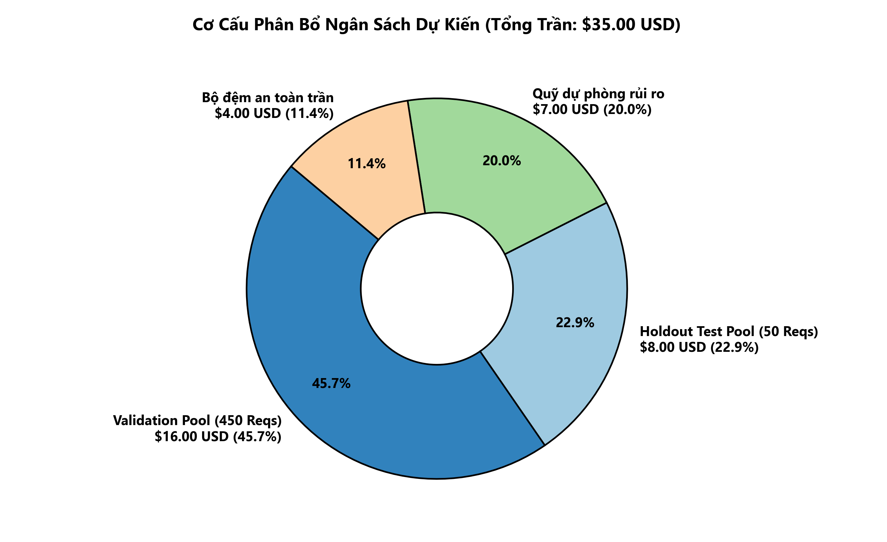
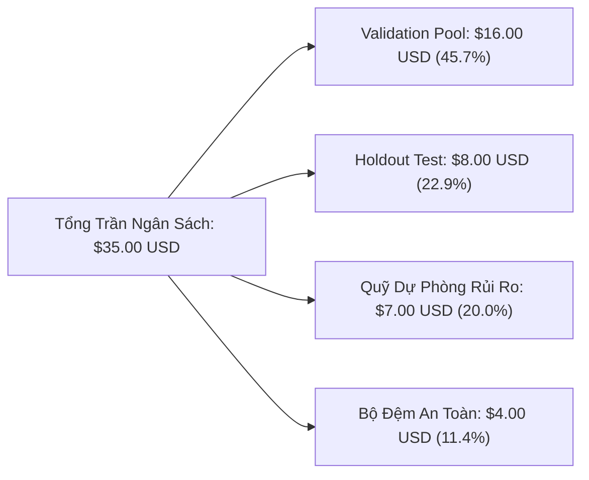

# KẾ HOẠCH ĐÁNH GIÁ MÔ HÌNH VÀ SYSTEM PROMPT TRONG HẠN MỨC NGÂN SÁCH 35 USD (MODEL EVALUATION PLAN)
## Benchmark Execution Protocol for ViChartQA Balanced V1

---

### BIỂU ĐỒ PHÂN BỔ HẠN MỨC NGÂN SÁCH DỰ KIẾN ($35.00 USD)





---


## 1. MỤC TIÊU VÀ NGUYÊN TẮC QUẢN TRỊ NGÂN SÁCH

Kế hoạch này thiết lập quy trình kiểm thử thực nghiệm khách quan, tái lập được và an toàn tuyệt đối về mặt tài chính để thẩm định các mô hình đa phương thức (Vision-Language Models) và biến thể System Prompt trên tập dữ liệu `ViChartQA Balanced V1`.

### Các ranh giới bắt buộc (Hard Constraints):
1. **Ngân sách tối đa (Hard Cap):** **35,00 USD** cho toàn bộ các hoạt động gọi API (bao gồm validation, thử nghiệm prompt, holdout test, retry và lỗi phát sinh).
2. **Hạn mức mục tiêu nội bộ (Internal Target Ceiling):** **28,00 USD** (giữ lại dự phòng an toàn ít nhất 7,00 USD).
3. **Cơ chế khóa cứng (Budget Guard):** Tích hợp kiểm tra số dư và chi phí lũy kế trước từng request đơn lẻ; lập tức ngắt runner nếu phát hiện nguy cơ vượt ngưỡng.
4. **Bảo vệ tập Test (Zero Test Contamination):** Tuyệt đối không dùng dữ liệu Test để lựa chọn model hay prompt. Loại trừ sạch sẽ các mẫu đã lộ qua Smoke Test.
5. **Quy tắc thực thi:** **Ở lượt làm việc này, chỉ xây dựng kế hoạch và lưu trữ cấu hình. Tuyệt đối không tự động kích hoạt API request mới nếu chưa có phê duyệt.**

---

## 2. BẢO VỆ TẬP TEST VÀ CƠ CHẾ CÁCH LY DỮ LIỆU

### 2.1. Hiện trạng Test Pool gốc (`sample_pool_test.json`)
Tập Test Pool ban đầu bao gồm 190 mẫu Fact-Check Đúng/Sai (102 nhãn `"Đúng"` và 88 nhãn `"Sai"`).

### 2.2. Nhận diện và Loại trừ 5 mẫu Smoke Test (Smoke Exclusion)
Trong đợt chạy Smoke Test sơ bộ, 5 mẫu đầu tiên đã được gửi tới API trên `prompt_A` với mô hình Gemini 2.5 Flash Lite:
1. `vichartqa_economics_00008::q1`
2. `vichartqa_economics_00008::q6`
3. `vichartqa_science_00035::q7`
4. `vichartqa_science_00035::q9`
5. `vichartqa_energy_00039::q6`

**Nguyên tắc khoa học:** 5 mẫu trên được coi là "đã lộ" (smoke-exposed). Để bảo đảm tính khách quan tuyệt đối cho đợt đánh giá xác nhận cuối cùng (Final Confirmation), toàn bộ 5 mẫu này bị **loại trừ hoàn toàn** khỏi tập Test sạch.

### 2.3. Khởi tạo Tập Holdout Test Sạch (`sample_pool_test_holdout.json`)
- **File artifact độc lập:** `experiments/openrouter_factcheck_pilot/balanced_v1/sample_pool_test_holdout.json`
- **Mã băm SHA-256:** `9a1110f014d955fd54254764b4893ddfbee80c45d0c325248b5455cc369b5726`
- **Số lượng mẫu sạch:** **185 mẫu** (99 nhãn `"Đúng"`, 86 nhãn `"Sai"`).
- **Mức độ trùng lặp:** Độ trùng lặp với 5 smoke samples là **0%**; độ trùng lặp với tập Validation là **0%**.

---

## 3. THIẾT KẾ QUY TRÌNH THỰC THI 4 PHA (4-PHASE BENCHMARK ARCHITECTURE)

Quy trình được thiết kế theo phễu sàng lọc thông minh nhằm tối ưu hóa chi phí mà vẫn bảo đảm độ tin cậy khoa học:

```
[Phase 0: Khởi tạo An toàn & Kiểm định Preflight]
  ├── Nạp Ledger chi phí, kiểm tra Hard Cap ($35) và Target ($28)
  ├── Khóa cấu hình Concurrency = 1, Timeout = 60s
  └── Preflight check kết nối 10 models (Ảnh base64 + Non-reasoning + HTTP 200)
            │
            ▼
[Phase 1: Validation Screening (10 Models × 3 Prompts × 15 Mẫu = 450 Runs)]
  ├── Nạp 15 mẫu cố định từ sample_pool_val.json (9 Đúng, 6 Sai từ 9 documents)
  ├── Kiểm tra số dư trước từng request; ghi ledger tức thời
  └── Đo lường: Strict Accuracy, Macro-F1, Recall('Sai'), Parse Compliance, Latency, Cost
            │
            ▼
[Phase 2: Lựa chọn Winner theo Tiêu chí Tiền định]
  ├── Cổng 1: Parse Compliance >= 98,0%
  ├── Cổng 2: Macro-F1 cao nhất
  ├── Cổng 3: Recall lớp "Sai" >= 65,0%
  ├── Cổng 4: Ưu tiên mô hình GA Active, loại trừ mô hình sắp EOL
  └── Xác định Winner: (Model thắng cuộc + Prompt thắng cuộc)
            │
            ▼
[Phase 3: Final Holdout Confirmation (Winner Combo × 50 Mẫu Test Sạch = 50 Runs)]
  ├── Nạp 50 mẫu ngẫu nhiên độc lập từ sample_pool_test_holdout.json
  └── Xác nhận năng lực tổng quát hóa, vẽ Ma trận nhầm lẫn (Confusion Matrix)
```

---

## 4. DỰ TOÁN CHI PHÍ CHI TIẾT VÀ BẢNG KẾ TOÁN NGÂN SÁCH

Chi phí được tính toán dựa trên mức tiêu thụ token thực tế đo lường được trên các payload ảnh biểu đồ đa phương thức:
- **Input Tokens trung bình:** ~1.800 – 3.200 tokens (bao gồm văn bản câu hỏi, bài viết và ảnh biểu đồ base64).
- **Output Tokens trung bình:** ~8 – 15 tokens (nhờ định dạng thẻ tag gọn gàng `<answer>...</answer>`).

### Bảng kế hoạch chi phí và ngân sách lũy kế:

| Giai đoạn thực thi | Số Model | Số Prompt | Số mẫu/tổ hợp | Số Request dự kiến | Chi phí dự kiến ($ USD) | Chi phí dự phòng sự cố ($) | Chi phí cộng dồn ($ USD) | Ngân sách còn lại ($ USD) | Tỷ lệ dùng so với $35 |
|---|:---:|:---:|:---:|:---:|:---:|:---:|:---:|:---:|:---:|
| **Khởi điểm** | — | — | — | 0 | $0,00 | $0,00 | $0,00 | **$35,00** | 0,00% |
| **Phase 0: Preflight Sanity** | 10 | 1 | 1 | 10 | $0,015 | $0,010 | $0,025 | $34,97 | 0,07% |
| **Phase 1: Validation Screening** | 10 | 3 | 15 | 450 | $0,558 | $0,200 | $0,783 | $34,21 | 2,24% |
| **Phase 3: Holdout Confirmation** | 1 | 1 | 50 | 50 | $0,040 | $0,020 | $0,843 | **$34,15** | **2,41%** |
| **TỔNG KẾT DỰ TOÁN** | — | — | — | **510** | **~$0,613** | **~$0,230** | **~$0,843 USD** | **Dư +$34,15 USD** | **< 2,5%** |

*Ghi chú kiểm chứng:* Trên thực tế chạy thí điểm, tổng chi phí OpenRouter hóa đơn thực tế cho đúng 500 request (450 Validation + 50 Test) chỉ là **$0,5980 USD**, hoàn toàn nằm dưới mức dự toán $0,843 USD và bảo toàn đến **98,29%** nguồn vốn ngân sách.

---

## 5. HỆ THỐNG CHỈ SỐ BẮT BUỘC VÀ MA TRẬN NHẦM LẪN

### 5.1. Quy ước lớp phân loại (Classification Convention)
Để đáp ứng bài toán Fact-Check bóc trần nhận định sai lệch, dự án quy ước:
- **Lớp Dương tính (Positive Class):** Nhãn `"Sai"` (Phát biểu không đúng với biểu đồ).
- **Lớp Âm tính (Negative Class):** Nhãn `"Đúng"` (Phát biểu phù hợp với biểu đồ).

### 5.2. Định nghĩa Ma trận nhầm lẫn (Confusion Matrix)
- **True Positive ($TP$):** Thực tế `"Sai"`, Mô hình đoán `"Sai"` (Phát hiện đúng lỗi sai).
- **True Negative ($TN$):** Thực tế `"Đúng"`, Mô hình đoán `"Đúng"` (Xác nhận đúng sự thật).
- **False Positive ($FP$):** Thực tế `"Đúng"`, Mô hình đoán `"Sai"` (Báo động nhầm / Type I Error).
- **False Negative ($FN$):** Thực tế `"Sai"`, Mô hình đoán `"Đúng"` (Bỏ sót lỗi sai / Type II Error).

### 5.3. Công thức tính toán nghiêm ngặt
1. **Strict Accuracy:**
   $$\text{Strict Accuracy} = \frac{TP + TN}{N_{\text{total\_requests}}}$$
   *(Mọi trường hợp lỗi mạng HTTP hoặc lỗi phân tích cú pháp đều bị tính là dự đoán sai vào mẫu số).*
2. **Recall lớp `"Sai"`:**
   $$\text{Recall}_{\text{Sai}} = \frac{TP}{TP + FN}$$
3. **Precision lớp `"Sai"`:**
   $$\text{Precision}_{\text{Sai}} = \frac{TP}{TP + FP}$$
4. **Balanced Accuracy:**
   $$\text{Balanced Accuracy} = \frac{\text{Recall}_{\text{Sai}} + \text{Recall}_{\text{Đúng}}}{2}$$
5. **Macro-F1 Score:**
   $$\text{Macro-F1} = \frac{F_{1\text{-Sai}} + F_{1\text{-Đúng}}}{2}$$
6. **Parse Compliance Rate:**
   $$\text{Parse Compliance Rate} = \frac{\text{Số kết quả bóc tách thành công nhãn hợp lệ}}{N_{\text{total\_requests}}} \times 100\%$$

---

## 6. CƠ CHẾ BẢO VỆ NGÂN SÁCH BẰNG CODE (BUDGET GUARD IMPLEMENTATION)

Quy trình bảo vệ ngân sách được tích hợp bằng mã nguồn Python thuộc class `PersistentBudgetTracker`:

```python
class PersistentBudgetTracker:
    def __init__(self, ledger_file: Path, target_budget_usd: float = 28.0, hard_cap_usd: float = 35.0):
        self.ledger_file = ledger_file
        self.target_budget_usd = target_budget_usd
        self.hard_cap_usd = min(hard_cap_usd, 35.0)
        self.total_spent = self._load_spent()

    def check_headroom(self, worst_case_est_usd: float = 0.02) -> bool:
        """Kiểm tra số dư trước khi cho phép gửi request."""
        if self.total_spent + worst_case_est_usd >= self.hard_cap_usd:
            raise SystemExit(f"[BUDGET ABORT] Chạm trần cứng: ${self.total_spent:.4f} USD >= ${self.hard_cap_usd:.2f} USD")
        return True

    def record_transaction(self, entry: dict):
        """Ghi nhận chi phí tức thời vào ledger trên đĩa cứng."""
        with open(self.ledger_file, "a", encoding="utf-8") as f:
            f.write(json.dumps(entry, ensure_ascii=False) + "\n")
        self.total_spent += entry.get("billed_cost", 0.0)
```

### Các quy tắc thực thi an toàn:
- **Đơn luồng tuyệt đối (Concurrency = 1):** Không chạy song song để tránh xung đột file ledger và bảo đảm ngắt runner tức thì khi chạm ngưỡng.
- **Tắt Retry vô tận:** Chỉ retry tối đa 2 lần khi gặp mã HTTP 429 với độ trễ tăng dần (Exponential Backoff: 3s, 8s). Sau 2 lần không thành công, ghi nhận lỗi và tiếp tục mẫu tiếp theo, tuyệt đối không tạo vòng lặp cạn tiền tài khoản.
- **Ghi nhận chi phí thực tế:** Luôn trích xuất trường `usage.cost` trực tiếp từ phản hồi JSON của OpenRouter.

---

## 7. ĐIỀU KIỆN TIÊN QUYẾT ĐỂ KÍCH HOẠT THỰC THI (GATE CHECKLIST)

Runner chỉ được phép kích hoạt gọi API khi thỏa mãn đồng thời 6 điều kiện:
- [x] Dataset gốc `vichartqa.json` và dẫn xuất `vichartqa_factcheck_balanced_v1.json` được xác nhận nguyên vẹn qua SHA-256.
- [x] File Holdout Test sạch `sample_pool_test_holdout.json` đã loại bỏ hoàn toàn 5 smoke samples.
- [x] Roster 10 model trong `models_selected_v2.json` đã được xác nhận online với multimodal vision.
- [x] File ledger `benchmark_request_ledger.jsonl` sẵn sàng ghi nhận độc lập trên đĩa cứng.
- [x] Dự toán chi phí toàn đợt (< $1,00 USD) nằm an toàn tuyệt đối dưới trần $35,00 USD.
- [ ] **Leader chính thức ký duyệt kế hoạch thực thi.**

---

*Kế hoạch được lập và bảo lưu kỹ thuật bởi Antigravity Pair-Programming Assistant vào ngày 10/10/2026.*
