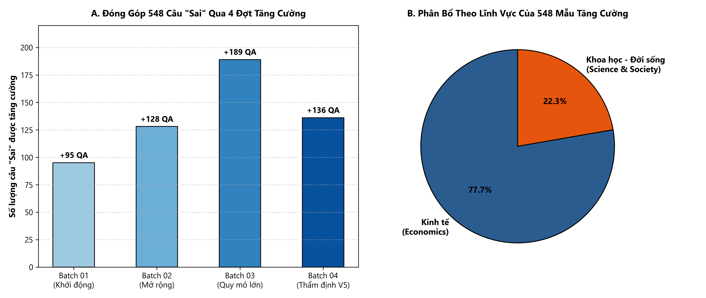
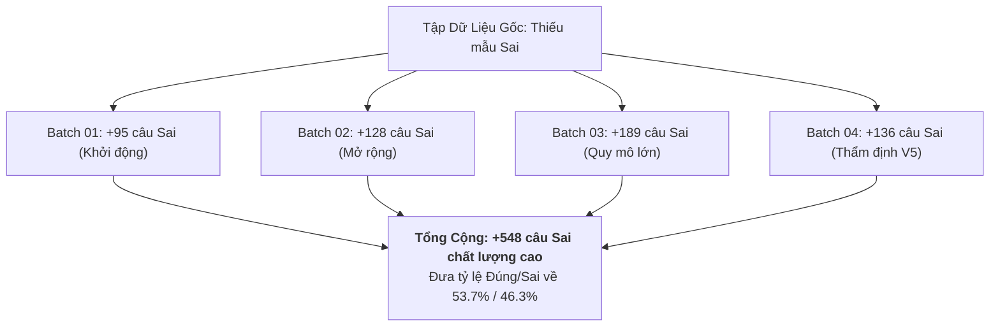

# LỊCH SỬ VÀ QUY TRÌNH CÂN BẰNG TẬP DỮ LIỆU FACT-CHECK (BALANCED V1)
## Tài liệu Kỹ thuật Tái lập Hành trình Tăng cường Dữ liệu ViChartQA

---

### BIỂU ĐỒ ĐÓNG GÓP CỦA 4 ĐỢT TĂNG CƯỜNG DỮ LIỆU (+548 CÂU 'SAI')





---


## 1. BỐI CẢNH VÀ ĐỘNG LỰC CÂN BẰNG DATASET

### 1.1. Hiện trạng Dataset gốc (`process/vichartqa.json`)
Dataset gốc `ViChartQA` là tập dữ liệu hỏi đáp đa phương thức dựa trên biểu đồ tiếng Việt đầu tiên có quy mô lớn, bao gồm các bài viết báo chí kinh tế, xã hội, y tế kèm biểu đồ đồ họa. Khi tiến hành kiểm đếm độc lập trực tiếp trên file nguồn `process/vichartqa.json` (SHA-256: `50be9c0d68f3d781004c1a7e50f5c15091e941af3352b41e01eba750fcd307c0`, kích thước 19.865.506 bytes), toàn bộ dataset có cấu trúc như sau:
- **Tổng số documents:** 1.242 tài liệu.
- **Tổng số cặp hỏi đáp (QA pairs):** 8.851 cặp.
- **Phân loại câu hỏi (`question_type`):**
  - `compositional`: 2.699 QA
  - `data_retrieval`: 1.213 QA
  - `fact_check`: 1.430 QA
  - `visual_compositional`: 1.302 QA
  - `visual`: 1.155 QA
  - `multiple_choice`: 575 QA
  - `unanswerable`: 477 QA

### 1.2. Vấn đề mất cân bằng nghiêm trọng trong nhóm Fact-Check
Trong nhóm `question_type == "fact_check"` (tổng 1.430 câu), các giá trị của trường nhãn `answer` phân bổ như sau:
- `Đúng`: 866 câu (60,56%)
- `Sai`: 200 câu (13,99%)
- `Có`: 306 câu (21,40%)
- `Không`: 53 câu (3,71%)
- `Phải`: 4 câu (0,28%)
- `Chưa`: 1 câu (0,07%)

Dự án tuân thủ nghiêm ngặt nguyên tắc khoa học dữ liệu: **Không tự ý gộp hoặc quy đổi nhãn ngữ nghĩa** (không chuyển `"Có"` thành Đúng, `"Không"` thành Sai). Khi tách riêng tập nhị phân đối kháng trực tiếp mang nhãn `['Đúng', 'Sai']`:
- **Tổng số câu Đúng/Sai ban đầu:** 1.066 câu.
- **Số câu `"Đúng"`:** 866 câu (**81,24%**).
- **Số câu `"Sai"`:** 200 câu (**18,76%**).
- **Tỷ lệ chênh lệch:** **4,33 : 1**.

```
[Phân bố Nhãn Fact-Check Gốc - 1.066 câu]
Đúng (866) : ████████████████████████████████ 81,24%
Sai  (200) : ███████ 18,76%
```

### 1.3. Hệ quả và Lý do không sửa/xóa dataset gốc
Sự mất cân bằng 81,24% / 18,76% tạo ra rủi ro nghiêm trọng cho các mô hình AI:
1. **Thiên lệch suy đoán (Majority Class Guessing Bias):** Mô hình chỉ cần luôn dự đoán `"Đúng"` là đã đạt Accuracy 81,24% mà không cần đọc biểu đồ.
2. **Ảo giác chấp nhận (Hallucination Vulnerability):** Mô hình không rèn luyện được năng lực phản biện, dễ dàng tin vào các nhận định sai lệch hoặc số liệu bị xuyên tạc.

**Lý do không xóa câu Đúng hoặc sửa trực tiếp dataset gốc:**
- Nếu xóa bớt câu `"Đúng"` (Down-sampling): Sẽ làm lãng phí 666 câu hỏi chất lượng cao do con người gán nhãn, làm giảm độ bao phủ miền tài liệu.
- Nếu chỉnh sửa trực tiếp `process/vichartqa.json`: Sẽ phá vỡ tính toàn vẹn của benchmark gốc, làm mất khả năng đối chuẩn với các nghiên cứu công bố trước đó.
- **Giải pháp tối ưu:** Tạo một bản sao dẫn xuất độc lập (`process/vichartqa_factcheck_balanced_v1.json`) và bổ sung các cặp nghịch đảo sai sự thật chất lượng cao (Fact-Check Inversion), tạo ra các cặp tương phản tối thiểu (minimal contrastive pairs) gắn liền với biểu đồ.

---

## 2. MỤC TIÊU CÂN BẰNG: TỪ SỐ HỌC ĐẾN CHỈ ĐẠO CỦA LEADER

### 2.1. Mục tiêu số học ban đầu
Về mặt lý thuyết toán học đơn thuần, để đưa 866 câu `"Đúng"` về tỷ lệ 50/50 hoàn hảo:
$$\text{Số câu Sai cần thêm} = 866 - 200 = 666 \text{ câu}.$$
Kế hoạch sản xuất giai đoạn 4 (Phase 4 Production) ban đầu dự kiến sinh khoảng 666–700 ứng viên đảo nhãn để bù đắp khoảng trống này.

### 2.2. Quyết định chiến lược của Leader
Trong quá trình thẩm định các batch thực tế, Leader đã đưa ra chỉ đạo dứt khoát:
> *“Không cần ép cứng đúng chính xác 50/50 về mặt số học. Mục tiêu hàng đầu là chất lượng câu hỏi, tính tự nhiên của câu văn tiếng Việt và buộc mô hình phải đọc biểu đồ. Nếu câu đảo bị gượng ép, lộ sơ hở suy luận từ văn bản (text shortcut) hoặc mâu thuẫn nội tại thì kiên quyết loại bỏ. Tỷ lệ gần cân bằng (near-balanced ~53% / 47%) là hoàn toàn phù hợp và khoa học.”*

### 2.3. Bảng phân định rõ ràng các cấp độ số lượng
Để tránh nhầm lẫn trong các báo cáo kỹ thuật, dự án phân biệt rạch ròi 5 khái niệm số lượng:
1. **Mục tiêu số học ban đầu:** +666 mẫu (để đạt 866/866).
2. **Quyết định của Leader:** Ưu tiên chất lượng, chấp nhận gần cân bằng (~53%/47%).
3. **Số lượng candidate được sản xuất:** 719 candidate (qua 4 batch).
4. **Số lượng accepted qua kiểm duyệt:** 548 candidate chính thức.
5. **Số lượng merge vào dataset dẫn xuất:** **Đúng 548 candidate**.
6. **Tỷ lệ thực tế đạt được:** **53,66% `"Đúng"` / 46,34% `"Sai"`** (rất gần 50/50 lý tưởng).

---

## 3. LỊCH SỬ SẢN XUẤT VÀ KIỂM DUYỆT THEO TỪNG BATCH

Quá trình tăng cường dữ liệu được tổ chức thành 4 đợt sản xuất (Phase 4 Batches 01–04) với quy trình kiểm duyệt hai reviewer độc lập (Dual-Reviewer Consensus) kết hợp các cổng lọc tự động.

### Bảng tổng hợp các Batch sản xuất và phân bổ Split:

| Batch sản xuất | Số source case xử lý | Accepted candidates | Train | Validation | Test | File nguồn artifact có thẩm quyền |
|---|:---:|:---:|:---:|:---:|:---:|---|
| **Phase 4 Batch 01** | 100 | **95** | 74 | 10 | 11 | `batch01/batch01_accepted_candidates.jsonl` |
| **Phase 4 Batch 02** | 150 | **128** | 97 | 14 | 17 | `batch02/batch02_accepted_candidates.jsonl` |
| **Phase 4 Batch 03** | 200 | **189** | 144 | 21 | 24 | `batch03/batch03_accepted_candidates.jsonl` |
| **Phase 4 Batch 04 (Cơ sở)** | 269 | **117** | 99 | 7 | 11 | `batch04/batch04_accepted_candidates.jsonl` |
| **Phase 4 Batch 04 (V5 Adjudicated)** | (từ 67 case thẩm định) | **19** | 12 | 3 | 4 | `batch04/batch04_human_adjudication_results_v5.csv` |
| **TỔNG CỘNG ĐÃ MERGE** | **719 source runs** | **548** | **426** | **55** | **67** | `merge_v1_manifest.json` |

---

### 3.1. Chi tiết Batch 01
- **Mục đích:** Khởi động dây chuyền sản xuất pilot quy mô nhỏ, kiểm chứng prompt sinh câu hỏi nghịch đảo (Inversion Prompt) trên 100 ca nguồn `vichartqa`.
- **Quy trình:** Sinh câu hỏi bằng mô hình ngôn ngữ lớn kết hợp trích xuất tọa độ biểu đồ, sau đó đưa qua 2 reviewer kiểm tra tính đúng đắn của mệnh đề sinh.
- **Tiêu chí:** Phép đảo phải tạo ra mệnh đề sai sự thật khi nhìn vào chart, nhưng vẫn tự nhiên về ngữ nghĩa và giữ nguyên thực thể chính.
- **Kết quả:** 95 mẫu đạt đồng thuận PASS (74 Train, 10 Val, 11 Test); 5 mẫu bị từ chối do câu sinh tối nghĩa hoặc đổi thực thể quá lộ liễu.

### 3.2. Chi tiết Batch 02
- **Mục đích:** Mở rộng quy mô lên 150 ca nguồn, tập trung vào các dạng biểu đồ đường và biểu đồ cột so sánh theo thời gian.
- **Quy trình:** Tăng cường bộ quy tắc đối chiếu: cấm đảo câu thành dạng phủ định thô thiển (như thêm chữ "không" đơn thuần), ép buộc đảo thuộc tính (tăng thành giảm, cao nhất thành thấp nhất, vượt qua thành xếp sau).
- **Kết quả:** 128 mẫu đạt đồng thuận PASS (97 Train, 14 Val, 17 Test); 22 mẫu bị từ chối.

### 3.3. Chi tiết Batch 03
- **Mục đích:** Xử lý 200 ca nguồn, bao gồm các biểu đồ tròn (Pie chart) về cơ cấu doanh thu, thị phần và biểu đồ phức hợp nhiều trục tung.
- **Quy trình:** Thiết lập cơ chế audit chéo giữa các reviewer để phát hiện các lỗi sai số học tinh vi (tổng tỷ lệ phần trăm biểu đồ tròn không khớp).
- **Kết quả:** 189 mẫu đạt đồng thuận PASS (144 Train, 21 Val, 24 Test); 11 mẫu bị loại bỏ.

---

## 4. QUÁ TRÌNH THẨM ĐỊNH CHUYÊN SÂU BATCH 04 (ADJUDICATION V1 ĐẾN V5)

Batch 04 là đợt sản xuất phức tạp nhất với 269 ca nguồn được đưa vào xử lý (`batch04_sources_269.jsonl`).

### 4.1. Sự phân hóa kết quả và Nhu cầu thẩm định chuyên sâu
Khi chạy qua hệ thống đánh giá hai reviewer độc lập:
- **117 ca:** Cả hai reviewer đồng thuận tuyệt đối PASS -> Đưa trực tiếp vào `batch04_accepted_candidates.jsonl`.
- **85 ca:** Cả hai reviewer đồng thuận REJECT -> Loại bỏ ngay lập tức.
- **67 ca:** Xuất hiện sự bất đồng giữa Reviewer 1 và Reviewer 2, hoặc xuất hiện cờ cảnh báo (warning flags) về nguy cơ text-only shortcut và nhầm lẫn checklist.
Toàn bộ 67 ca này được đóng gói vào tập thẩm định chuyên sâu (`batch04_human_adjudication_packet.csv`) kèm trích xuất ảnh biểu đồ tương ứng (`batch04_adjudication_67_images.zip`).

### 4.2. Hệ thống 5 Cổng Kiểm Soát Chất Lượng (5-Gate Quality Framework)
Mỗi ứng viên trong nhóm 67 ca phải trải qua 5 cổng kiểm tra nghiêm ngặt:
- **Cổng 1 (Ground Truth Verifiability):** Mệnh đề gốc trong dataset phải thực sự Đúng dựa trên bài viết và biểu đồ.
- **Cổng 2 (Empirical Chart Inversion):** Mệnh đề sinh sau khi đảo phải thực sự Sai khi đối chiếu trực quan với biểu đồ.
- **Cổng 3 (Anti Text-Only Shortcut):** Người giải **bắt buộc phải nhìn biểu đồ mới biết câu đó Sai**. Nếu chỉ đọc bài viết mà đã suy luận ra câu đó Sai (text shortcut), ứng viên lập tức bị REJECT.
- **Cổng 4 (Figure Alignment):** Ảnh biểu đồ liên kết trong câu hỏi phải khớp chính xác với biểu đồ chứa dữ liệu cần chứng minh.
- **Cổng 5 (Minimal Contrastive Inversion):** Phép đảo chỉ thay đổi quan hệ so sánh hoặc thông số cốt lõi, bảo toàn ngữ cảnh thực thể, mốc thời gian và độ tự nhiên.

### 4.3. Quá trình thu hẹp qua các vòng V1 đến V5
- **Vòng V1–V3:** Khảo sát các ca bất đồng; phát hiện Reviewer 2 thường nhầm lẫn lỗi `INTERNAL_CONTRADICTION` (do câu sinh mâu thuẫn với biểu đồ — điều này là đúng mục tiêu tạo câu Sai). Đồng thời phát hiện Reviewer 1 có một số ca giải thích text là PASS nhưng tick nhầm boolean checklist.
- **Vòng V4:** Đề xuất 21 ca đạt chuẩn sau khi lọc bỏ các ca mâu thuẫn biểu đồ.
- **Vòng V5 (Chỉ đạo siết chặt của Leader):** Rà soát lại nguy cơ text shortcut ở mức độ khắt khe nhất. Phát hiện 2 ứng viên có nguy cơ lộ manh mối văn bản và loại bỏ ngay lập tức:
  1. `p4_b04_010` (`vichartqa_economics_00495_q4` — Test): Bài báo ghi rõ vốn chào bán gấp đôi năm ngoái, nhưng câu sinh lại hỏi "sụt giảm xuống đáy". Người đọc bài báo có thể loại trừ mà không cần xem biểu đồ -> **REJECT**.
  2. `p4_b04_133` (`vichartqa_education_00992_q5` — Train): Bài báo nêu rõ điểm kỹ năng Singapore đứng đầu ASEAN, câu sinh lại hỏi Singapore thấp nhất. Người đọc bài có thể suy luận kiến thức mà không cần nhìn biểu đồ -> **REJECT**.
- **Kết quả V5 chính thức:**
  - **19 ca ACCEPT_FOR_FALSE_SET** (12 Train, 3 Val, 4 Test).
  - **48 ca REJECT** (loại bỏ hoàn toàn).
  - **Trạng thái phê duyệt:** Đã được Leader phê duyệt chính thức.

### 4.4. Danh sách 19 ID Batch 04 V5 được Leader phê duyệt:
- **Test (4 mẫu):** `p4_b04_009`, `p4_b04_015`, `p4_b04_024`, `p4_b04_029`
- **Validation (3 mẫu):** `p4_b04_250`, `p4_b04_255`, `p4_b04_265`
- **Train (12 mẫu):** `p4_b04_037`, `p4_b04_066`, `p4_b04_084`, `p4_b04_094`, `p4_b04_155`, `p4_b04_157`, `p4_b04_163`, `p4_b04_172`, `p4_b04_225`, `p4_b04_226`, `p4_b04_227`, `p4_b04_228`

### 4.5. Đối soát quan hệ giữa 117 ca ban đầu và 19 ca V5
Kiểm tra đối chiếu tập hợp mã định danh (set intersection) giữa file `batch04_accepted_candidates.jsonl` (117 mẫu) và danh sách 19 mẫu trong `batch04_human_adjudication_results_v5.csv`:
- **Số lượng ID trùng nhau:** **0 mẫu** (Hoàn toàn tách rời).
- **Bản chất:** 117 mẫu là các ca đồng thuận vòng 1; 19 mẫu là các ca thẩm định bổ sung từ nhóm 67 ca nghi vấn.
- **Tổng số mẫu Batch 04 thực tế được merge:** $117 + 19 = 136$ mẫu.
- Không có bất kỳ hiện tượng đếm trùng, trùng lặp ID hay cộng gộp sai lệch.

---

## 5. QUY TRÌNH MERGE VÀO DATASET DẪN XUẤT (`BALANCED V1`)

### 5.1. Nguyên tắc cách ly và bảo toàn
1. **Dataset gốc (`process/vichartqa.json`):** Tuyệt đối ở chế độ Read-Only, không thực hiện bất kỳ lệnh ghi nào. Mã băm SHA-256 được kiểm tra đối chiếu liên tục: `50be9c0d68f3d781004c1a7e50f5c15091e941af3352b41e01eba750fcd307c0`.
2. **Dataset dẫn xuất (`process/vichartqa_factcheck_balanced_v1.json`):** Được khởi tạo bằng cách sao chép cấu trúc của dataset gốc, sau đó bổ sung chính xác 548 câu hỏi mới vào đúng các document cha tương ứng.
3. **Kế thừa thuộc tính phân vùng (Split Inheritance):** Câu hỏi mới được thêm vào document nào thì tự động mang phân vùng split (`train`, `val`, `test`) của document đó, bảo đảm tuyệt đối không làm lệch split hay rò rỉ dữ liệu giữa các tập.

### 5.2. Cấu trúc câu hỏi mới được chèn
Mỗi câu hỏi mới trong 548 mẫu đều tuân thủ đầy đủ schema gốc của ViChartQA:
```json
{
  "question_id": "q9",
  "question": "Đúng hay sai: Mức tăng CPI 3,63% của năm 2024 được nhắc đến trong bài viết hoàn toàn khớp với giá trị của điểm thấp nhất trên \"Biến động chỉ số CPI Việt Nam giai đoạn từ 2018 đến nay\"?",
  "answer": "Sai",
  "question_type": "fact_check",
  "figure_id": "fig1",
  "evidence_hops": ["fig1", "text"],
  "source_candidate_id": "vichartqa_economics_00308_q2",
  "batch_sample_id": "p4_b04_009"
}
```

---

## 6. THỐNG KÊ TOÀN DIỆN TRƯỚC VÀ SAU KHI CÂN BẰNG

*(Số liệu được tính toán trực tiếp từ mã nguồn phân tích JSON độc lập trên cả 2 tệp dữ liệu).*

### 6.1. Bảng so sánh tổng thể

| Chỉ số đo lường | Dataset gốc (`vichartqa.json`) | Dataset dẫn xuất (`vichartqa_factcheck_balanced_v1.json`) | Biến động (+/-) | Nhận xét |
|---|:---:|:---:|:---:|---|
| **Kích thước file (bytes)** | 19.865.506 | 20.741.671 | +876.165 | Bổ sung nội dung 548 QA mới |
| **Mã băm SHA-256** | `50be9c...307c0` | `98d72f...df201` | Độc lập | File gốc giữ nguyên vẹn |
| **Tổng số Documents** | 1.242 | 1.242 | 0 | Không thêm bớt tài liệu |
| **Tổng số QA Pairs** | 8.851 | 9.399 | +548 | 100% thuộc fact_check |
| **Fact-check 'Đúng'** | 866 | 866 | 0 | Giữ nguyên 100% câu Đúng gốc |
| **Fact-check 'Sai'** | 200 | **748** | **+548** | Tăng thêm 548 câu Sai chất lượng |
| **Tổng nhóm Đúng / Sai** | 1.066 | **1.614** | +548 | Tăng dung lượng kiểm thử nhị phân |
| **Tỷ lệ nhãn 'Đúng'** | **81,24%** | **53,66%** | -27,58% | **Triệt tiêu thiên lệch quá mức** |
| **Tỷ lệ nhãn 'Sai'** | **18,76%** | **46,34%** | +27,58% | **Đạt trạng thái gần cân bằng** |

### 6.2. Phân bổ chi tiết nhãn Đúng / Sai theo Split sau Merge

| Phân vùng (Split) | Đúng (Gốc) | Sai (Gốc) | Thêm mới (Sai) | Tổng Đúng sau merge | Tổng Sai sau merge | Tổng QA Đúng/Sai | Tỷ lệ Đúng / Sai sau merge |
|---|:---:|:---:|:---:|:---:|:---:|:---:|:---:|
| **Train** | 668 | 158 | **+426** | 668 | **584** | 1.252 | **53,35% / 46,65%** |
| **Validation** | 96 | 21 | **+55** | 96 | **76** | 172 | **55,81% / 44,19%** |
| **Test** | 102 | 21 | **+67** | 102 | **88** | 190 | **53,68% / 46,32%** |
| **TỔNG CỘNG** | **866** | **200** | **+548** | **866** | **748** | **1.614** | **53,66% / 46,34%** |

```
[Phân bố Nhãn Fact-Check sau Cân bằng - 1.614 câu]
Đúng (866) : █████████████████████ 53,66%
Sai  (748) : ██████████████████ 46,34%
```

---

## 7. KIỂM ĐỊNH CHẤT LƯỢNG VÀ TOÀN VẸN HẬU MERGE

Sau khi hoàn tất quá trình merge, một quy trình kiểm thử tự động nghiêm ngặt đã được thực thi và ghi nhận trong `merge_v1_post_audit.md`:
1. **Kiểm tra tính toàn vẹn file gốc:** SHA-256 của `process/vichartqa.json` không đổi (`PASS`).
2. **Kiểm tra Schema JSON:** File dẫn xuất parse thành công 100%, tuân thủ cấu trúc trường dữ liệu chuẩn (`PASS`).
3. **Kiểm tra trùng lặp (Zero Duplicates):**
   - 0 duplicate `candidate_id` hoặc `batch_sample_id`.
   - 0 duplicate nội dung câu hỏi trong 548 mẫu mới.
   - 0 xung đột văn bản với bất kỳ câu hỏi nào trong 8.851 câu gốc (`PASS`).
4. **Kiểm tra rò rỉ mẫu bị từ chối (Zero Leakage):** Kiểm tra đối chiếu toàn bộ 48 mẫu bị từ chối tại vòng V5 (như `p4_b04_010`, `p4_b04_133`, `p4_b04_035`). Xác nhận: **Không có bất kỳ mẫu reject nào xuất hiện trong dataset dẫn xuất** (`PASS`).
5. **Kiểm tra khớp Manifest:** Số lượng mẫu trong `merge_v1_manifest.json` khớp hoàn hảo 548/548 với số lượng record thực tế trong JSON dẫn xuất (`PASS`).

---

## 8. BÀI HỌC KINH NGHIỆM VÀ KẾT LUẬN

1. **Chất lượng hơn số lượng:** Việc Leader quyết định không ép cứng 50/50 mà dừng ở 53,66% / 46,34% là hoàn toàn đúng đắn. Việc loại bỏ các mẫu có nguy cơ text shortcut giúp bảo đảm rằng bài toán Fact-Check thực sự đánh giá năng lực thị giác máy tính và đọc hiểu biểu đồ, thay vì chỉ kiểm tra trí nhớ ngôn ngữ.
2. **Bảo toàn dữ liệu là nguyên tắc sống còn:** Việc tạo dataset dẫn xuất `Balanced V1` giúp dự án vừa sở hữu tập dữ liệu cân bằng cho các bài toán phân loại nhị phân hiện đại, vừa bảo vệ toàn vẹn di sản dữ liệu gốc `ViChartQA`.
3. **Tính tái lập hoàn toàn (Full Reproducibility):** Toàn bộ lịch sử từ 719 ca nguồn, 548 mẫu accepted, 67 ca thẩm định, 19 ca V5 đến các mã băm SHA-256 đều được lưu vết đầy đủ trong các file manifest và script, sẵn sàng cho bất kỳ đợt thanh tra hay công bố khoa học nào.
