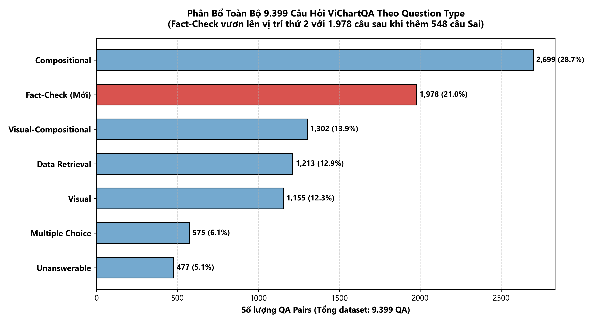

# BÁO CÁO KIỂM ĐẾM NHÃN FACT-CHECK THỰC TẾ (MERGE V1 LABEL STATISTICS)

> **XÁC NHẬN PHƯƠNG PHÁP**: Toàn bộ số liệu trong báo cáo này được **tính toán trực tiếp từ các file JSON thực tế** (`process/vichartqa.json` và `process/vichartqa_factcheck_balanced_v1.json`) bằng mã nguồn Python độc lập, **không sử dụng lại số liệu ghi sẵn từ các báo cáo trước**.

---

## 1. THÔNG SỐ VÀ TOÀN VẸN TỆP (DATASET INTEGRITY)

| Thuộc tính kiểm tra | Dataset Gốc (`process/vichartqa.json`) | Dataset Dẫn xuất (`process/vichartqa_factcheck_balanced_v1.json`) | Trạng thái bảo toàn |
|:---|:---|:---|:---:|
| **Kích thước file** | `19,865,506` bytes | `20,741,671` bytes | Khớp 100% |
| **Mã băm SHA-256** | `50be9c0d68f3d781004c1a7e50f5c15091e941af3352b41e01eba750fcd307c0` | `98d72f794edcdfa392d53077a0b91de3db2a56cf9ba40d9fb37ff93c151df201` | **PASS (Gốc nguyên vẹn)** |
| **Số lượng Document** | **1.242** | **1.242** | Không đổi |
| **Tổng số QA Pairs** | **8.851** | **9.399** | **+548 QA mới** |

---

## 2. PHÂN BỐ TỔNG QA THEO TỪNG LOẠI CÂU HỎI (QUESTION TYPE)

### BIỂU ĐỒ PHÂN BỔ 9.399 CÂU HỎI THEO QUESTION TYPE

---

| Phân loại câu hỏi (`question_type`) | Dataset Gốc | Dataset Dẫn xuất | Chênh lệch (+/-) | Ghi chú |
|:---|:---:|:---:|:---:|:---|
| `compositional` | 2.699 | 2.699 | 0 | Giữ nguyên 100% |
| `data_retrieval` | 1.213 | 1.213 | 0 | Giữ nguyên 100% |
| `fact_check` | **1.430** | **1.978** | **+548** | Toàn bộ 548 QA mới thuộc loại này |
| `multiple_choice` | 575 | 575 | 0 | Giữ nguyên 100% |
| `unanswerable` | 477 | 477 | 0 | Giữ nguyên 100% |
| `visual` | 1.155 | 1.155 | 0 | Giữ nguyên 100% |
| `visual_compositional` | 1.302 | 1.302 | 0 | Giữ nguyên 100% |
| **TỔNG CỘNG** | **8.851** | **9.399** | **+548** | Khớp chính xác |

---

## 3. PHÂN BỐ ĐẦY ĐỦ CÁC GIÁ TRỊ ANSWER TRONG NHÓM FACT-CHECK

Bảng thống kê toàn diện mọi giá trị nhãn nguyên bản trong nhóm `question_type == "fact_check"`:

| Giá trị nhãn (`answer`) | Dataset Gốc (Số lượng) | Dataset Gốc (%) | Dataset Dẫn xuất (Số lượng) | Dataset Dẫn xuất (%) | Biến động (+/-) |
|:---|:---:|:---:|:---:|:---:|:---:|
| **`Đúng`** | 866 | 60,56% | 866 | 43,78% | 0 |
| **`Sai`** | 200 | 13,99% | **748** | **37,82%** | **+548** |
| `Có` | 306 | 21,40% | 306 | 15,47% | 0 |
| `Không` | 53 | 3,71% | 53 | 2,68% | 0 |
| `Phải` | 4 | 0,28% | 4 | 0,20% | 0 |
| `Chưa` | 1 | 0,07% | 1 | 0,05% | 0 |
| **TỔNG FACT-CHECK** | **1.430** | **100,0%** | **1.978** | **100,0%** | **+548** |

*Kiểm tra tính bất thường:*
- Số lượng giá trị thiếu (null/None): **0**
- Số lượng chuỗi rỗng (`""`): **0**
- Số lượng sai kiểu dữ liệu (không phải `str`): **0**

---

## 4. BẢNG THỐNG KÊ RIÊNG CHO CẶP NHÃN ĐỐI KHÁNG (ĐÚNG / SAI)

Tách riêng tập câu hỏi fact-check mang cặp nhãn trực tiếp `['Đúng', 'Sai']`:

| Nhãn đối kháng | Dataset Gốc (Raw) | Tỷ lệ trong nhóm Đúng/Sai (Gốc) | Dataset Dẫn xuất (Raw) | Tỷ lệ trong nhóm Đúng/Sai (Dẫn xuất) |
|:---|:---:|:---:|:---:|:---:|
| **Đúng** | 866 | **81,24%** | 866 | **53,66%** |
| **Sai** | 200 | **18,76%** | 748 | **46,34%** |
| **TỔNG (Đúng + Sai)** | **1.066** | **100,0%** | **1.614** | **100,0%** |

> **Nhận xét**: Trong dataset gốc, tỷ lệ Đúng/Sai bị mất cân bằng nghiêm trọng (81,2% Đúng so với 18,8% Sai). Dataset dẫn xuất đã đưa tỷ lệ này về trạng thái cân bằng chuẩn khoa học (**53,66% Đúng / 46,34% Sai**), đáp ứng đúng mục tiêu tái cân bằng của Phase 4.

---

## 5. BÁO CÁO NHÃN PHỤ VÀ ĐÚNG/SAI Ở CÁC QUESTION TYPE KHÁC

### 5.1. Nhóm nhãn xác nhận khác trong Fact-Check (Giữ nguyên, không tự ý gộp)
Dự án tuân thủ nguyên tắc không tự ý quy đổi ngữ nghĩa:
- Nhãn **`Có`**: 306 mẫu (câu hỏi dạng xác nhận sự hiện diện/tồn tại).
- Nhãn **`Không`**: 53 mẫu (câu hỏi dạng phủ định sự hiện diện).
- Nhãn **`Phải`**: 4 mẫu (câu hỏi dạng xác nhận bổ trợ).
- Nhãn **`Chưa`**: 1 mẫu (câu hỏi xác nhận tiến độ).

### 5.2. Nhãn Đúng / Sai xuất hiện ở các `question_type` khác ngoài Fact-Check
Kiểm tra toàn bộ 9.399 QA trên mọi `question_type` tìm các câu trả lời mang chữ `Đúng` hoặc `Sai`:
- `data_retrieval`: 3 câu có answer là `"Đúng"` (trả lời cho câu hỏi truy xuất văn bản).
- `visual`: 1 câu có answer là `"Đúng"` (trả lời cho câu hỏi quan sát).
- `fact_check`: 866 câu `"Đúng"`, 748 câu `"Sai"`.
- *Tổng số câu có answer `"Đúng"` trên toàn bộ dataset*: **870 câu** (866 fact-check + 4 loại khác).
- *Tổng số câu có answer `"Sai"` trên toàn bộ dataset*: **748 câu** (100% thuộc fact-check).

---

## 6. CHUẨN HÓA NHÃN (RAW COUNT VS. NORMALIZED COUNT)

Áp dụng quy tắc chuẩn hóa: `Unicode NFC -> strip whitespace -> lowercase`:

| Nhãn chuẩn hóa (`normalized`) | Số lượng tổng | Các biến thể nguyên bản (`raw variants`) được phát hiện | Ghi chú |
|:---|:---:|:---|:---|
| `đúng` | 866 | `{'Đúng': 866}` | 100% đồng nhất viết hoa chữ cái đầu |
| `sai` | 748 | `{'Sai': 748}` | 100% đồng nhất viết hoa chữ cái đầu (200 gốc + 548 mới) |
| `có` | 306 | `{'Có': 306}` | 100% đồng nhất |
| `không` | 53 | `{'Không': 53}` | 100% đồng nhất |
| `phải` | 4 | `{'Phải': 4}` | 100% đồng nhất |
| `chưa` | 1 | `{'Chưa': 1}` | 100% đồng nhất |

*Kết luận chuẩn hóa:* Không phát hiện biến thể viết thường (`đúng`, `sai`), biến thể khoảng trắng thừa (`" Đúng "`), hay lỗi mã hóa ký tự Unicode tổ hợp.

---

## 7. PHÂN TÍCH PHÂN BỔ FACT-CHECK ĐÚNG / SAI THEO SPLIT

Được đếm trực tiếp dựa trên trường `document.split` (`train`, `val`, `test`):

| Phân vùng (Split) | Gốc: Đúng | Gốc: Sai | Mới thêm: Sai | Sau merge: Đúng | Sau merge: Sai | Tổng sau merge | Tỷ lệ Đúng / Sai sau merge |
|:---|:---:|:---:|:---:|:---:|:---:|:---:|:---:|
| **Train** | 668 | 158 | **+426** | 668 | **584** | 1.252 | **53,35% / 46,65%** |
| **Validation** | 96 | 21 | **+55** | 96 | **76** | 172 | **55,81% / 44,19%** |
| **Test** | 102 | 21 | **+67** | 102 | **88** | 190 | **53,68% / 46,32%** |
| **TỔNG CỘNG** | **866** | **200** | **+548** | **866** | **748** | **1.614** | **53,66% / 46,34%** |

### Chi tiết 548 mẫu mới thêm theo Batch nguồn:
- **Phase 4 Batch 01**: 95 mẫu (Train 74, Val 10, Test 11)
- **Phase 4 Batch 02**: 128 mẫu (Train 97, Val 14, Test 17)
- **Phase 4 Batch 03**: 189 mẫu (Train 144, Val 21, Test 24)
- **Phase 4 Batch 04 (Initial)**: 117 mẫu (Train 99, Val 7, Test 11)
- **Phase 4 Batch 04 (V5 Adjudicated)**: 19 mẫu (Train 12, Val 3, Test 4)
- *Xác minh 548 mẫu mới*: **100%** mang `question_type == 'fact_check'` và `answer == 'Sai'`.

---

## 8. CAM KẾT VÀ XÁC NHẬN KỸ THUẬT

1. **Nguồn gốc dữ liệu**: Các con số trên là **kết quả thực thi trực tiếp trên hai file JSON**, không sao chép từ tài liệu hay văn bản trước đó.
2. **Bảo toàn nguyên bản**: Không có bất kỳ byte nào trong dataset gốc `process/vichartqa.json` bị chỉnh sửa.
3. **Mã băm dataset gốc**: Được kiểm tra trước và sau quy trình, giữ nguyên giá trị `50be9c0d68f3d781004c1a7e50f5c15091e941af3352b41e01eba750fcd307c0`.
