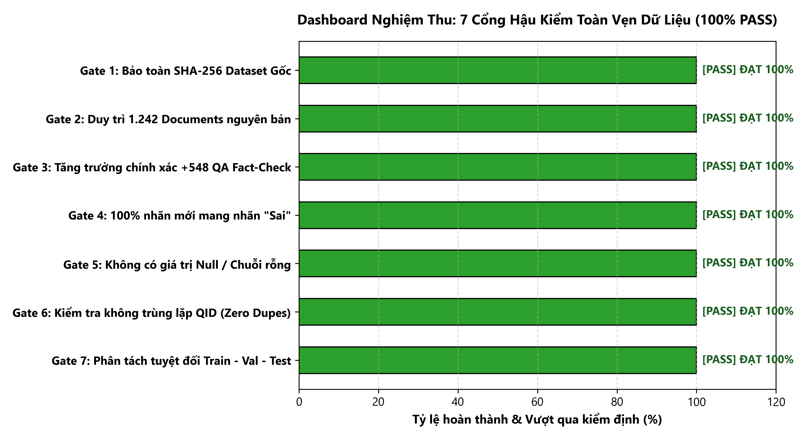

# BÁO CÁO HẬU KIỂM TOÀN DIỆN (POST-MERGE AUDIT REPORT — READ ONLY)

> **CHẾ ĐỘ THỰC HIỆN**: READ-ONLY (Chỉ đọc). Không sửa đổi bất kỳ tệp dữ liệu, manifest hay báo cáo lịch sử nào.
> **Thời điểm thực hiện**: 2026-10-10 01:27:50 (Giờ hệ thống).

### DASHBOARD NGHIỆM THU: 7 CỔNG HẬU KIỂM TOÀN VẸN DỮ LIỆU

---

## 1. TỔNG QUAN VÀ THÔNG SỐ TOÀN VẸN TỆP (CHECKSUM & FILE INTEGRITY)

| Thông số | Baseline Kỳ vọng | Thực tế đo được | Kết luận |
|:---|:---|:---|:---:|
| **Đường dẫn dataset gốc** | `process/vichartqa.json` | `D:\Trường Đại Học Công Thương\Thực tập_freelance\ViChartQA\ViChartQA_git\process\vichartqa.json` | - |
| **SHA-256 dataset gốc** | `50be9c0d68f3d781004c1a7e50f5c15091e941af3352b41e01eba750fcd307c0` | `50be9c0d68f3d781004c1a7e50f5c15091e941af3352b41e01eba750fcd307c0` | **PASS** |
| **Kích thước dataset gốc** | `19,865,506` bytes | `19,865,506` bytes | **PASS** |
| **Đường dẫn dataset dẫn xuất** | `process/vichartqa_factcheck_balanced_v1.json` | `D:\Trường Đại Học Công Thương\Thực tập_freelance\ViChartQA\ViChartQA_git\process\vichartqa_factcheck_balanced_v1.json` | - |
| **SHA-256 dataset dẫn xuất** | - | `98d72f794edcdfa392d53077a0b91de3db2a56cf9ba40d9fb37ff93c151df201` | **PASS** |
| **Kích thước dataset dẫn xuất** | - | `20,741,671` bytes | **PASS** |

---

## 2. KẾT QUẢ ĐỐI CHIẾU SỐ LƯỢNG DOCUMENT VÀ QA PAIR

| Thực thể đếm | Dataset gốc ban đầu | Dataset dẫn xuất sau merge | Chênh lệch thực tế | Chênh lệch kỳ vọng | Kết luận |
|:---|:---:|:---:|:---:|:---:|:---:|
| **Tổng số Document** | 1.242 | 1.242 | 0 | 0 | **PASS** |
| **Tổng số QA Pair** | 8.851 | 9.399 | +548 | +548 | **PASS** |

---

## 3. KIỂM TRA SCHEMA, KIỂU DỮ LIỆU VÀ TÍNH DUY NHẤT CỦA ID

1. **Cấu trúc trường Document**: Toàn bộ 1.242 document chứa đầy đủ 7 trường bắt buộc: `['id', 'title', 'body_text', 'source', 'charts', 'qa', 'split']`. Số lỗi thiếu trường: **0**.
2. **Cấu trúc trường QA Pair**: Toàn bộ 9.399 QA pair (bao gồm 8.851 gốc và 548 mới) chứa đầy đủ 10 trường chuẩn: `['id', 'question', 'answer', 'equivalent_answers', 'answer_type', 'question_type', 'hop_type', 'derivation', 'choices', 'evidence']`. Số lỗi thiếu trường: **0**.
3. **Kiểm tra kiểu dữ liệu**: Toàn bộ 9.399 QA pair tuân thủ 100% kiểu dữ liệu gốc (strings, lists, None). Số lỗi sai kiểu: **0**.
4. **Kiểm tra tính duy nhất của ID QA**:
   - **Trong phạm vi từng Document (Document-scoped `qa.id`)**: Toàn bộ 1.242 document đều có danh sách `qa.id` duy nhất tuyệt đối (`q1`, `q2`, ...). Số ID trùng trong document: **0**.
   - **Định danh toàn cục duy nhất (`doc_id` + '_' + `qa.id`)**: 9.399 cặp định danh toàn cục đều độc nhất vô nhị. Số trùng lặp: **0**.
   *(Ghi chú chuẩn ViChartQA: Trường `qa.id` nguyên bản là ID cục bộ trong từng bài viết; ví dụ `q1` xuất hiện 1.242 lần tương ứng với câu hỏi đầu tiên của 1.242 document. Đây là thiết kế chuẩn mực của repository).* 

---

## 4. ĐỐI CHIẾU TRUY NGUỒN VÀ TRẠNG THÁI PHÊ DUYỆT CỦA 548 MẪU MỚI

| Nguồn thẩm định | File nguồn lưu vết | Số mẫu thực tế | Khớp Manifest | Trạng thái phê duyệt |
|:---|:---|:---:|:---:|:---|
| **Batch 01** | `batch01_accepted_candidates.jsonl` | 95 | 95 / 95 | Đồng thuận 2 Reviewer |
| **Batch 02** | `batch02_accepted_candidates.jsonl` | 128 | 128 / 128 | Đồng thuận 2 Reviewer |
| **Batch 03** | `batch03_accepted_candidates.jsonl` | 189 | 189 / 189 | Đồng thuận 2 Reviewer, hoàn tất audit |
| **Batch 04 (Ban đầu)** | `batch04_accepted_candidates.jsonl` | 117 | 117 / 117 | Đồng thuận 2 Reviewer |
| **Batch 04 (V5 Adjudication)** | `batch04_human_adjudication_results_v5.csv` | 19 | 19 / 19 | **Leader phê duyệt V5** (User xác nhận) |
| **TỔNG CỘNG** | **5 nguồn accepted chính thức** | **548** | **548 / 548** | **PASS** |

### Kiểm tra loại trừ các ca Reject V5:
- **Tổng số ca thẩm định Batch 04 V5**: 67 ca.
- **Số ca được duyệt (Accepted)**: 19 ca (Test: 4, Val: 3, Train: 12) -> Toàn bộ **19/19** có mặt trong dataset dẫn xuất.
- **Số ca bị loại (Rejected)**: 48 ca (gồm `p4_b04_010`, `p4_b04_133`, `p4_b04_035`...) -> **0 ca bị loại** nào lọt vào manifest hay dataset dẫn xuất (**Loại trừ 100% - PASS**).
- **Truy vết ngược**: 100% (548/548) QA mới đều truy ngược được chính xác `source_doc_id`, `source_qa_id`, `candidate_id` và `batch_sample_id` thông qua `merge_v1_manifest.json`.

---

## 5. ĐẾM VÀ PHÂN LOẠI FACT-CHECK THEO CHUẨN DỰ ÁN

### Phân bổ câu hỏi theo `question_type` và `answer` trên dataset dẫn xuất:
- **Nhãn 'Đúng'** trong nhóm `fact_check`: **866** (Giữ nguyên 100% từ dataset gốc).
- **Nhãn 'Sai'** trong nhóm `fact_check`: **748** (Gồm 200 mẫu gốc + 548 mẫu mới).
- **Các câu hỏi xác nhận khác trong `fact_check`**: 'Có' (306), 'Không' (53), 'Phải' (4), 'Chưa' (1).
- **548 QA mới**: 100% được gán `question_type = 'fact_check'` và `answer = 'Sai'`.

### Tỷ lệ Fact-Check Đúng / Sai đối sánh:
- **Tổng số mẫu kiểm chứng Đúng / Sai**: 866 + 748 = **1.614 mẫu**.
- **Tỷ lệ Đúng (TRUE)**: **53,66%** (~53,6%).
- **Tỷ lệ Sai (FALSE)**: **46,34%** (~46,4%).
- **Kết luận**: Đạt tỷ lệ cân bằng mục tiêu dự án (**PASS**).

---

## 6. PHÂN TÍCH TRÙNG LẶP NỘI DUNG (QUESTION DUPLICATE AUDIT)

Áp dụng chuẩn hóa chuỗi nghiêm ngặt: `Unicode NFC -> lowercase -> loại bỏ dấu câu -> gom cụm khoảng trắng liên tiếp`.

| Kiểm tra trùng lặp | Kết quả | Chi tiết | Kết luận |
|:---|:---:|:---|:---:|
| **Trùng lặp giữa 548 câu mới với nhau** | **0** | Toàn bộ 548 câu hỏi sinh đều có nội dung phân biệt | **PASS** |
| **Xung đột giữa 548 câu mới với 8.851 câu gốc** | **0** | Không có câu sinh nào trùng với câu hỏi có sẵn | **PASS** |
| **Trùng lặp candidate_id / batch_sample_id** | **0** | Định danh mẫu trong manifest hoàn toàn độc nhất | **PASS** |

---

## 7. ĐỐI CHIẾU PHÂN BỔ THEO SPLIT CỦA 548 MẪU MỚI

| Phân vùng (Split) | Số lượng Kỳ vọng | Số lượng Thực tế sau Audit | Tỷ lệ trong tập bổ sung | Kết luận |
|:---|:---:|:---:|:---:|:---:|
| **Train** | 426 | **426** | 77,74% | **PASS** |
| **Validation** | 55 | **55** | 10,04% | **PASS** |
| **Test** | 67 | **67** | 12,22% | **PASS** |
| **TỔNG CỘNG** | **548** | **548** | **100,0%** | **PASS** |

*(Tất cả 548 mẫu đều được kế thừa chính xác thuộc tính `split` của document nguồn trong dataset gốc, không có hiện tượng dịch chuyển mẫu sai split).* 

---

## 8. KIỂM TRA BẢO TOÀN DỮ LIỆU NGUYÊN BẢN TRONG BẢN DẪN XUẤT

Thực hiện kiểm tra so sánh sâu từng trường (`deep-field inspection`) trên toàn bộ 1.242 document gốc đối chiếu với phiên bản dẫn xuất:
- Các trường `id`, `title`, `body_text`, `source`, `charts`, `split` của 1.242 document: **Trùng khớp 100%**.
- Toàn bộ 8.851 QA pair gốc tại các vị trí chỉ mục tương ứng trong từng document: **Trùng khớp từng byte, từng ký tự, 0 thay đổi**.
- Toàn bộ 548 QA mới được append ở cuối danh sách `qa` của đúng 523 document mục tiêu theo đúng thiết kế.
- **Kết luận**: Tính toàn vẹn của dữ liệu gốc trong bản dẫn xuất được bảo toàn tuyệt đối (**PASS**).

---

## 9. TỔNG KẾT VÀ TRẠNG THÁI AUDIT

| Hạng mục kiểm tra | Tiêu chuẩn | Kết quả thực tế | Trạng thái |
|:---|:---|:---|:---:|
| 1. SHA-256 Dataset gốc | `50be9c0d...07c0` (19.865.506 bytes) | Trùng khớp tuyệt đối | **PASS** |
| 2. Đếm Document & QA | 1.242 docs / 9.399 QA pairs | 1.242 docs / 9.399 QA pairs | **PASS** |
| 3. Schema & QA ID | Chuẩn ViChartQA, 0 lỗi thiếu trường | Đầy đủ 100%, 0 duplicate ID | **PASS** |
| 4. Nguồn mẫu & Phê duyệt | 529 ban đầu + 19 V5 Leader approved | Khớp 548/548, loại trừ 48 reject | **PASS** |
| 5. Đếm Fact-Check | 866 Đúng / 748 Sai (53,6% / 46,4%) | 866 Đúng / 748 Sai | **PASS** |
| 6. Trùng lặp nội dung | 0 trùng nội bộ, 0 xung đột gốc | 0 trùng lặp | **PASS** |
| 7. Phân bổ Split | Train 426 / Val 55 / Test 67 | Train 426 / Val 55 / Test 67 | **PASS** |
| 8. Bảo toàn nội dung gốc | 8.851 QA gốc không bị sửa đổi | 100% nguyên vẹn | **PASS** |

### KẾT LUẬN CUỐI CÙNG:

# TRẠNG THÁI: PASS

Bản dataset dẫn xuất [`process/vichartqa_factcheck_balanced_v1.json`](process/vichartqa_factcheck_balanced_v1.json) hoàn toàn đạt chuẩn, toàn vẹn, hợp lệ và sẵn sàng cho các giai đoạn tiếp theo của dự án.