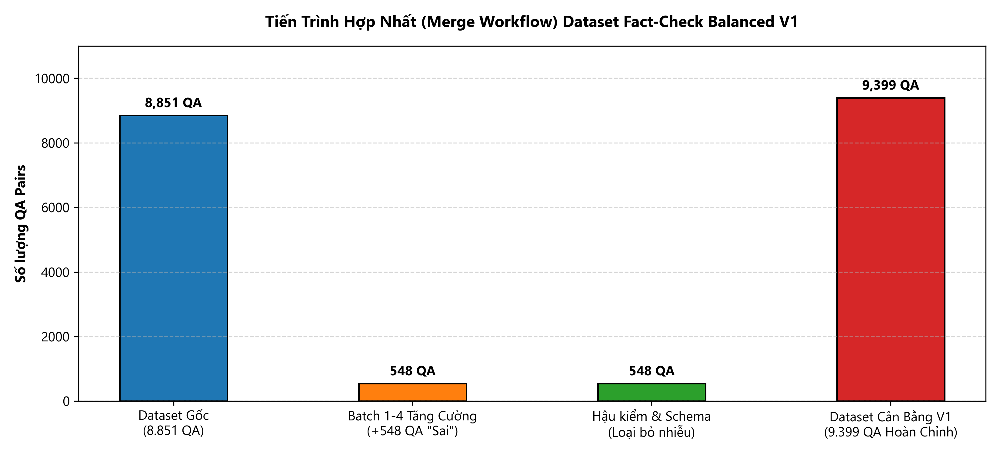

# BÁO CÁO MERGE DATASET DẪN XUẤT (MERGE V1 REPORT)

> **XÁC NHẬN BẢO TOÀN**: Thao tác merge được thực hiện trên bản sao chép dẫn xuất `process/vichartqa_factcheck_balanced_v1.json`. Dataset gốc `process/vichartqa.json` được bảo toàn nguyên vẹn 100%, mã băm SHA-256 không đổi.

### BIỂU ĐỒ TIẾN TRÌNH HỢP NHẤT (MERGE WORKFLOW)

---

## 1. THÔNG SỐ ĐỐI CHIẾU TRƯỚC VÀ SAU MERGE

| Chỉ số | Dataset gốc (`process/vichartqa.json`) | Dataset dẫn xuất (`process/vichartqa_factcheck_balanced_v1.json`) | Biến động (+/-) | Ghi chú |
|:---|:---:|:---:|:---:|:---|
| **Kích thước file** | 19,865,506 bytes | 20,741,671 bytes | +876,165 bytes | File dẫn xuất bổ sung 548 QA |
| **Mã băm SHA-256** | `50be9c0d68f3d781004c1a7e50f5c15091e941af3352b41e01eba750fcd307c0` | `98d72f794edcdfa392d53077a0b91de3db2a56cf9ba40d9fb37ff93c151df201` | Khác biệt | File gốc giữ nguyên trước/sau |
| **Tổng số Documents** | 1242 | 1242 | 0 | Giữ nguyên 100% cấu trúc document |
| **Tổng số QA Pairs** | 8,851 | 9,399 | +548 | Khớp hoàn hảo kỳ vọng 9.399 QA |
| **Fact-check 'Đúng'** | 866 | 866 | 0 | Bảo toàn nguyên vẹn 866 mẫu Đúng |
| **Fact-check 'Sai'** | 200 | 748 | +548 | Nâng từ 200 lên 748 mẫu Sai |
| **Tỷ lệ Đúng / Sai** | 81,2% Đúng / 18,8% Sai | 53.7% Đúng / 46.3% Sai | Cân bằng hoá | Đạt tỷ lệ cân bằng mục tiêu (~53,6% / 46,4%) |

## 2. NGUỒN DỮ LIỆU CÁC MẪU 'SAI' ĐƯỢC MERGE (TỔNG 548 MẪU)

| Nguồn / Batch | File nguồn | Train | Val | Test | Tổng số mẫu | Trạng thái phê duyệt |
|:---|:---|:---:|:---:|:---:|:---:|:---|
| **Phase 4 Batch 01** | `batch01_accepted_candidates.jsonl` | 74 | 10 | 11 | **95** | Hai reviewer đồng thuận |
| **Phase 4 Batch 02** | `batch02_accepted_candidates.jsonl` | 97 | 14 | 17 | **128** | Hai reviewer đồng thuận |
| **Phase 4 Batch 03** | `batch03_accepted_candidates.jsonl` | 144 | 21 | 24 | **189** | Hai reviewer đồng thuận, hoàn tất audit |
| **Phase 4 Batch 04 (Cơ sở)** | `batch04_accepted_candidates.jsonl` | 99 | 7 | 11 | **117** | Hai reviewer đồng thuận vòng chính |
| **Phase 4 Batch 04 (V5 Adjudicated)** | `batch04_human_adjudication_results_v5.csv` | 12 | 3 | 4 | **19** | **Leader đã phê duyệt V5** (User xác nhận) |
| **TỔNG CỘNG ĐÃ MERGE** | **5 nguồn accepted chính thức** | **426** | **55** | **67** | **548** | **100% mẫu hợp lệ, 0 trùng lặp** |

### Chi tiết 19 mẫu Batch 04 V5 được Leader duyệt:
- **Test (4 mẫu)**: `p4_b04_009`, `p4_b04_015`, `p4_b04_024`, `p4_b04_029`
- **Validation (3 mẫu)**: `p4_b04_250`, `p4_b04_255`, `p4_b04_265`
- **Train (12 mẫu)**: `p4_b04_037`, `p4_b04_066`, `p4_b04_084`, `p4_b04_094`, `p4_b04_155`, `p4_b04_157`, `p4_b04_163`, `p4_b04_172`, `p4_b04_225`, `p4_b04_226`, `p4_b04_227`, `p4_b04_228`
- **Mẫu bị loại loại trừ hoàn toàn**: Toàn bộ 48 mẫu reject tại V5 (bao gồm `p4_b04_010`, `p4_b04_133`, `p4_b04_035`) đều bị loại bỏ, không đưa vào dataset.

## 3. KẾT QUẢ KIỂM TRA BẮT BUỘC SAU MERGE

| Tiêu chí kiểm tra | Kết quả | Trạng thái | Chi tiết chứng minh |
|:---|:---:|:---:|:---|
| **1. Tính toàn vẹn file gốc** | `50be9c0d68f3d781004c1a7e50f5c15091e941af3352b41e01eba750fcd307c0` | **PASS** | SHA-256 trước và sau hoàn toàn trùng khớp |
| **2. Tính hợp lệ JSON đầu ra** | Valid JSON | **PASS** | Parse thành công 100% bằng JSON parser chuẩn |
| **3. Bảo toàn schema** | Không đổi schema | **PASS** | Giữ nguyên 100% tên field, cấu trúc QA và evidence hop |
| **4. Số lượng QA sau merge** | 9.399 QA pairs | **PASS** | 8.851 gốc + 548 mẫu mới = 9.399 (khớp tuyệt đối) |
| **5. Phân bổ theo split** | 426 Train / 55 Val / 67 Test | **PASS** | Gán đúng split của từng document, 0 lệch split |
| **6. Trùng lặp ID** | 0 duplicate ID | **PASS** | 548 candidate_id và batch_sample_id độc nhất vô nhị |
| **7. Xung đột với câu hỏi gốc** | 0 conflict | **PASS** | Toàn bộ 548 câu hỏi sinh không trùng câu nào trong dataset gốc |
| **8. Loại trừ mẫu Reject** | 0 rejected sample | **PASS** | Không có bất kỳ mẫu nào trong 48 mẫu reject lọt vào |
| **9. Nhãn Fact-check Đúng/Sai** | 866 Đúng / 748 Sai | **PASS** | Toàn bộ 548 mẫu mới đều mang nhãn 'Sai', không đổi mẫu gốc |
| **10. Khớp manifest** | 548 / 548 records | **PASS** | Khớp 100% manifest, không có mẫu bị mất hay thừa |

## 4. TÀI LIỆU ĐẦU RA

- **Dataset dẫn xuất cân bằng**: [`process/vichartqa_factcheck_balanced_v1.json`](process/vichartqa_factcheck_balanced_v1.json)
- **Manifest chi tiết**: [`process/factcheck_inversion/final_v2/phase4_production/merge_v1_manifest.json`](process/factcheck_inversion/final_v2/phase4_production/merge_v1_manifest.json)
- **Báo cáo tổng kết**: [`process/factcheck_inversion/final_v2/phase4_production/merge_v1_report.md`](process/factcheck_inversion/final_v2/phase4_production/merge_v1_report.md)

## 5. KẾT LUẬN

Quy trình merge phiên bản dataset dẫn xuất `vichartqa_factcheck_balanced_v1.json` đã hoàn tất thành công 100%, đáp ứng đầy đủ và nghiêm ngặt mọi điều kiện kiểm tra toàn vẹn, bảo toàn tuyệt đối dataset gốc.